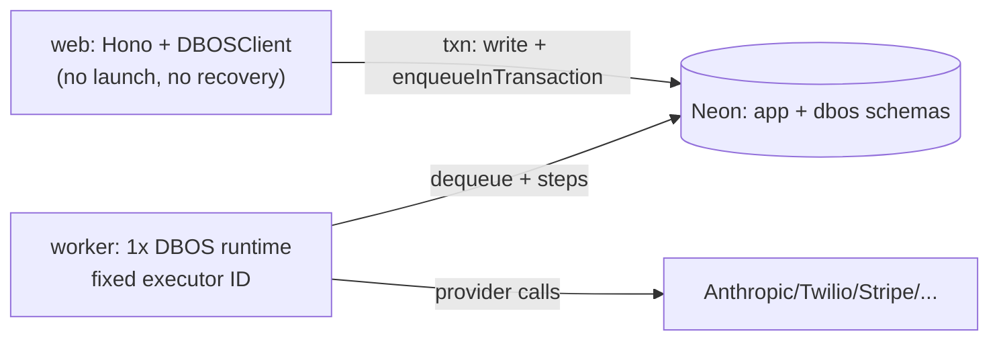

# OpenLevel Architecture V2 — Profitable, DBOS-Powered Agency SaaS

- **Deliverable for:** `docs/plans/prompt5.md` (FINAL ARCHITECTURE V2 DIRECTIVE).
- **Inputs inspected:** `docs/plans/prompt3.md`, `docs/plans/plan5.md`,
  `docs/architecture/OPENLEVEL_DBOS_FLY_NEON_IMPLEMENTATION_PLAN.md` (V1),
  `docs/plans/plan5_review.md`, `docs/plans/llms.txt` (DBOS doc index).
  Reviews treated as adversarial commentary per §1: accepted where valid,
  rejected where contradicted (each rejection noted).
- **Checkout:** branch `master`, commit `2634f8c`
  (`2634f8cd0eaccfdc9d589fad3fc967fd1b3ba0bb`), investigated 2026-11-14.
- **Method note:** no Node.js toolchain or `node_modules` in this
  environment; tests unexecuted (honestly disclosed, never claimed).
  All counts use fixed-string or exact-enumeration methods with the
  command stated. Negative findings state their search method.
- **External sources:** official docs only, accessed 2026-11-14
  (Appendix S). TypeScript docs for TypeScript claims. SDK clone
  (`dbos-transact-ts` @ `e94db66`) supplemental only, never authoritative.
- **Paths** relative to the git root.

## Labels

- **[Verified]** — observed in the checkout or cited official docs.
- **[Assumption]** — default needing confirmation, measurement, or load test.
- **[Recommendation]** — advised choice with rationale and ADR.
- **[Needs approval]** — owner decision; not settled here.
- **[Proposed]** — new behavior to build.

## 1. Executive recommendation and architecture verdict

**Verdict: sound after specific corrections — and simpler than V1.**

The technology choices (TypeScript, DBOS, Neon, Fly, shared tenancy on
`location_id`) are sound. The V1 assembly is not: it preserves quirks not
worth preserving, runs DBOS in the web tier for no reason, bridges two
schemas in one database with a bespoke outbox pump, and leaves recovery
and versioning undesigned. Both plan5_review critiques are substantially
correct on defects 1–7 (matrices, dual-write, arithmetic, replay,
drain cap, recovery, versioning); I accept them and this document is the
correction, not a patch list.

**[Recommendation]** Ship this instead:

- **Web:** Hono + `DBOSClient` only. No `DBOS.launch()`, no recovery, no
  dequeue. Atomic business-write + `enqueueInTransaction()` in one
  Postgres transaction. No outbox, no pump.
- **Worker:** one DBOS worker Machine at launch with a fixed executor ID
  (`DBOS__VMID=worker-1`), patching discipline for version safety, and
  delayed-continuation workflows (not parked sleeps) for long journeys.
  Buy Conductor ($99/mo) when a second worker is justified.
- **Data:** one Neon database, `app` + `dbos` schemas. Stable business
  UUIDs + unique constraints for dedup (since `enqueueInTransaction`
  lacks `return-existing`). Three DB roles, reconciled connection budget.
- **Commercial first:** agency model, Stripe billing, AI-credit wallet
  with hard stops, and metering ship in Phase 1 — before the DBOS
  cutover, not after. Launch wedge: agency OS (capture → CRM → inbox →
  booking → follow-up → AI engagement → snapshots).
- **Clean start:** no live production state was found (see §3), so no
  dual-write, no per-tenant flags, no legacy-run adoption beyond one
  honest script. Owner confirms before anything destructive.

What V1 got right and is kept: the tenant verdict (`location_id` as the
boundary), the two real defects (waits die; enqueue is non-transactional),
the 12+2 side-effect framing, partition-by-tenant fairness, and honest
test disclosure. What is dropped: outbox pump, custom DLQ tables,
per-tenant cutover machinery, 8-phase roadmap, custom admin UI, and 100%
behavior parity (workflow sends become real sends under explicit gates).

Five-question verdict: fidelity holds for contracts that matter (routes,
tenancy, money boundaries) while log-only quirks are intentionally
retired; isolation is enforceable via validated workflow context,
partitions, and (phased) RLS; durability comes from native DBOS recovery
with a designed executor/version story; one operator can run one app, one
DB, one dashboard; early economics work only with wallet hard-stops from
day one — which is why billing ships first.

## 2. Product strategy, target customer, scope and non-goals

**[Recommendation]** Launch wedge — agency operating system for
lead-driven local businesses (the repo's own seed is a cash-offers
real-estate buyer; schema comments cite AZ/NC leads, i.e. US market
evidence):

1. Lead capture (forms, funnels, trigger links). 2. Contact CRM +
   pipeline. 3. Unified conversations. 4. Appointment scheduling.
5. Automated follow-up. 6. AI-assisted engagement. 7. Reusable
   agency snapshots/templates.

Ideal customer: 5–50-seat home-services / real-estate / med-spa agencies
running client acquisition on SMS + speed-to-lead, currently stitching
GoHighLevel + spreadsheets. Willingness-to-pay evidence required before
pricing commits: 10 paid pilots at a stated price, not surveys.

| Capability (14 ranked) | V2 disposition | Rationale |
|---|---|---|
| Lead capture/forms/funnels | Retain + harden | Wedge core; public routes already solid |
| CRM contacts/pipelines | Retain | Wedge core |
| Conversations/inbox | Retain; Chatwoot stays for now | Wedge core; own channels later (§8) |
| Appointment booking | Retain | Wedge core; unique-index honesty kept |
| Campaigns (SMS/email) | Improve → real chunked sends | Highest duplicate-send risk; needs §7 design |
| Workflow automation | Rebuild on DBOS | The durability payoff |
| AI replies/actions | Improve + meter | Margin-critical; wallet-gated |
| Landing pages/funnels | Retain (hosted pages) | Snapshot content |
| Reviews/reputation | Defer (sync later) | No launch dependency |
| Social publishing | Defer (manual publish stays) | Scheduled publish is Phase 3 |
| Courses/communities | Retire from launch scope | Breadth without wedge value; code stays, unpromoted |
| Affiliates | Defer | Post-launch growth lever |
| Analytics/reporting | Minimal (digest later) | Dashboards after metering exists |
| Voice/calls | Improve carefully | Real-time + cost; operator-initiated only |

**Non-goals:** GoHighLevel parity; visual workflow builder (JSON
definitions + snapshots instead); database-per-tenant; multi-region;
custom admin UI before Conductor evaluation; DBOS Cloud (closed to new
users per `llms.txt` — never recommend).

## 3. Verified repository and production-state inventory

### 3.1 Corrected counts (fixed-string methods)

| Measure | Value | Method |
|---|---|---|
| Non-test TS files | 228 | `find … -name '*.ts' ! -name '*.test.ts' \| wc -l` |
| Test files | 182 | `find … -name '*.test.ts' \| wc -l` |
| Endpoint registrations | 230 exact | `grep -rho -F` of 5 method literals, `--exclude='*.test.ts'` (28 DELETE, 84 GET, 40 PATCH, 75 POST, 3 PUT) |
| Schema tables | 58 | `grep -c -F 'CREATE TABLE'` |
| Tests touching real Postgres | 0 files | `grep -rl -F -e 'new Pool(' -e 'PgDatabase('` on `*.test.ts` |
| Operator `role` enforcement | none found | `grep -rn -F 'role ==='` hits are chat-message roles only; `auth.ts` returns `role` in JSON without checking it |

V1 findings re-confirmed (spot re-reads): pg-boss retry constants
(`boss.ts:27-38`), log-only workflow sends (`workflow-runner.ts:116-137`),
`setTimeout`+`unref` waits (lines 52–63), send-then-persist
(`outbound.ts:62-88`), dedupe-before-enqueue edge
(`webhooks-chatwoot.ts:70-99`), Square random-suffix key
(`square-adapter.ts:45`), no Stripe `Idempotency-Key` header, no
registration/provisioning endpoints, env-name secret split
(`vault.ts:12-15`).

New since V1: `client_slug` is nullable with **no uniqueness
constraint** (schema lines 3–11), and 9 resolver call sites use
`client_slug ?? slug` as the env-secret namespace — so multiple
locations **can** share one secret namespace today (many-to-one
permitted, no observed instance in the single-location seed). Metering
and credential ownership must treat `client_slug` as untrusted grouping
until the agency model replaces it. Docker/deploy inventory: no
`Dockerfile`, `fly.toml`, `docker-compose.yml`, or `.env` anywhere
(`ls` + `find -maxdepth 2 -iname '*fly*'` empty); the one historical
`deploy.ps1` (commit `fd6e2b6`, mobile-only) was deleted.

### 3.2 Live-state verdict → **Strategy A (clean start)**

Evidence weigh-in (all read-only; no prod contact per §3):

- For live state: a plausible Chatwoot hostname in `.env.example`
  (example config, alongside `dev-secret` — not proof); gateway rail
  references (external service, not in repo).
- Against: zero deploy artifacts; docs describe laptop-only runs;
  seed is demo fixtures; mobile defaults to `localhost:8790`; git
  history is features/screenshots with no deploy/release commits;
  `deepwiki.md` frames paying customers as future work.

**[Recommendation]** Proceed as **Strategy A — new launch**. Residual
unknown (an external prod DB cannot be disproven from the repo) is
handled by a hard gate: **owner must confirm "no live customer state" in
writing before Phase 2 deletes pg-boss paths or fails any adopted run.**
Strategy B (controlled migration) is specified condensely in §15 for use
only if that confirmation fails.

## 4. Agency, account, location and tenant model

**[Recommendation]** Minimal three-table addition; no org/workspace
forest:

- `agencies(id, owner_operator_id, stripe_customer_id, plan, branding,
  custom_domain, created_at)` — the billing and resale unit.
- `agency_members(agency_id, operator_id, role)` — roles `owner`,
  `admin`, `member`, enforced in middleware (unlike today's unenforced
  `role`).
- `locations.agency_id` (nullable during backfill, then NOT NULL) —
  every location belongs to exactly one agency.

Ownership and rules: agency owns locations, Stripe subscription,
white-label config, snapshots, and the AI-credit wallet; locations own
domain rows, per-location provider links, and quotas carved from agency
entitlements. Operator → agency membership → location access replaces
direct `operator_locations` (migrated: each existing membership becomes
single-location agency membership). Snapshots export/import location
config JSON (funnels, pipelines, automations, agent prompt, templates)
within or across an agency's locations.

Tenant isolation in workflows: `agency_id` + `location_id` are both
required workflow arguments, validated at step 1 against the source row;
queue partition key stays `location_id` (finer-grained fairness), with
agency-level rate caps as a second limiter where plans require it.

RLS evaluation: Postgres RLS with `SET LOCAL app.tenant_id` inside an
explicit per-operation transaction is compatible with transaction-mode
pooling (session `SET` would leak across tenants — verified across
multiple practitioner sources; must be re-verified against Neon docs at
implementation). **[Recommendation]** Do NOT enable RLS at launch:
application scoping is audited and tested, while RLS adds failure modes
(forgotten `SET LOCAL` fails closed and breaks reads; prepared-plan
sharing; worker/datasource interplay) with no compliance driver yet.
Pilot RLS on 3 high-risk tables (messages, invoices, credentials) in
Phase 3 with a dedicated test matrix, then decide. Privileged roles
(`migrator`, table owners) bypass RLS by design — documented, never used
at runtime.

## 5. Target runtime and deployment architecture

**[Recommendation]** One Fly app, one image, one `fly.toml`, two process
groups, one region (`iad` — US market evidence in §2; Singapore only if
SEA targeting is evidenced **[Needs approval]**), one Neon database.



Request path: authenticate → authorize (agency + location) → single
Postgres transaction on a direct sysdb connection: business write +
`enqueueInTransaction()` with a stable business UUID → commit → respond.
Duplicate webhook/request retries hit the same UUID + unique constraint
and converge. Worker path: dequeue from tenant-partitioned queues,
execute steps (transactional datasource ops for mutations, guarded
provider calls for externals), sleep-short / delay-continue for waits
(§7). No outbox table, no pump, no `LISTEN` dependency at launch.

Machine plan: web 2× `shared-cpu-1x` 512MB (availability without
autoscale complexity; autostop OFF at launch for predictability),
worker 1× `shared-cpu-1x` 1GB via `fly scale count` (not
`min_machines_running`, which only governs serviced groups —
[Fly workers](https://fly.io/learn/background-workers/)),
`kill_signal = "SIGTERM"`, `kill_timeout = 120s` (default SIGINT/5s
would murder model-call steps — same source). Scale triggers: web on
p95/request queueing; second worker only with Conductor (§10).

## 6. pg-boss versus DBOS evaluation

Fair baseline first — pg-boss v12 (repo pins `^12.18.2`) is more capable
than V1 assumed (all verified in official pg-boss docs at
`github.com/timgit/pg-boss/docs`, accessed 2026-11-14):

- **Transactional enqueue:** `db` option on `send`/`insert`/`complete`/
  `fetch` joins a caller-owned transaction via `executeSql`
  (`docs/database-backends.md`); ORM adapters shipped.
- **Delayed work:** `startAfter` (seconds/ISO/Date), `sendAfter()`.
- **Dedup/throttle:** `singletonKey` + `singletonSeconds/Minutes/Hours`,
  `singletonNextSlot`.
- **Scheduling:** `boss.schedule` cron (documented; verified via API
  references in search results).
- **Workers:** handler + completion in one transaction; retry/expire/
  retention/cancel APIs.

So both V1 defects (dying waits, non-transactional enqueue) are fixable
in pg-boss: `startAfter` continuations + `db`-option sends + a persisted
automation state machine. The honest question is what DBOS adds beyond
that — and it is substantial:

| Measure | A. pg-boss improved | B. DBOS-only **[Recommendation]** | C. Hybrid |
|---|---|---|---|
| Multi-step recovery | Hand-rolled state machine | Native checkpoints + replay | DBOS parts only |
| Waits at 10k–100k journeys | `startAfter` rows (workable) | `delaySeconds` DELAYED status, no memory | Either |
| Version safety | None (code discipline) | Patching + versions + fork | DBOS parts only |
| Tenant fairness | Manual (no partitions) | Native partitioned queues | Split-brain |
| Exactly-once DB mutations | Manual idempotency | Transactional datasources | Split |
| Scheduled work | `boss.schedule` cron | DB-native schedules + backfill | Two schedulers |
| Ops surface | One engine, custom tooling | One engine + Conductor option | Two engines + handoff |
| Checkpoint/storage overhead | Job rows only | Checkpoints (measured in §13) | Both |
| Cost/10k + /100k exec | Formula in §13 | Formula in §13 | Highest (dual run) |
| 100 → 10k accounts | Fairness tooling custom | Partitions + Conductor path | Worst |

**One recommendation: B. DBOS-only.** pg-boss *could* be stretched to
cover the requirements, but every stretch (state machine, fairness,
versioning, recovery) is custom code the team owns forever, while DBOS
provides each natively. What DBOS does that pg-boss cannot do adequately
without custom code: checkpointed multi-step recovery, durable
delayed-continuations at journey scale, patch-based version safety, and
tenant-partitioned fairness. No second engine: C's handoff (ownership,
dual retry regimes, dual DLQs) is pure liability with no measured
benefit. Revisit trigger: Phase 2 benchmarks showing DBOS checkpoint
cost dominating a high-volume simple workload (then: pg-boss for that
workload only, with the handoff fields from V1 ADR-1).

## 7. DBOS workflows, transactions, queues and delayed work

### 7.1 Atomic enqueue: `enqueueInTransaction` wins, outbox loses

**[Recommendation]** Web handlers use `DBOSClient.enqueueInTransaction()`
([TS client reference](https://docs.dbos.dev/typescript/reference/client),
accessed 2026-11-14): the business write and the enqueue commit or roll
back together in a caller-owned transaction on the sysdb connection.
Verified constraints from the same reference: caller owns begin/commit/
rollback/retry, and `duplicationPolicy: 'return-existing'` is
**unsupported** here. Dedup therefore comes from the application layer:
every trigger computes a stable business UUID (e.g. `msg:{messageId}`,
`evt:{webhookProvider}:{providerEventId}`) stored under a unique
constraint; a retried request replays the same UUID and converges via
`ON CONFLICT`, and the workflow itself is started with that UUID so
double-enqueue collapses.

The V1 outbox + 5s pump is rejected: ~17k pump executions/day of pure
overhead, a second state machine (leases, visibility timeouts), and
5s enqueue latency — all to bridge two schemas that live in one
Postgres. An outbox returns only if a future need (multi-consumer audit
stream, app/sysdb split) justifies it; the pump would then be a
`LISTEN`-driven poller, not a cron workflow.

### 7.2 Transactional datasources: adopt surgically

**[Recommendation]** Adopt `@dbos-inc/node-pg-datasource`
([TS datasource reference](https://docs.dbos.dev/typescript/reference/datasource)):
transaction functions commit user SQL + completion record atomically,
giving exactly-once DB mutations across replays. Adaptation: keep the
`Database.query()` interface for reads and non-critical writes; add a
`TransactableDatabase` path (same interface, datasource-backed client)
used **only** by: (1) usage-ledger reservation/settlement, (2) send-marker
and `outbound_operations` transitions, (3) payment/invoice state
transitions, (4) run-projection writes that must not double-apply.
Everything else stays ordinary queries — explicitly NOT exactly-once,
and designed idempotent instead (unique keys, conditional updates).
`transaction_completion` tables live in the `dbos` schema, migrated by
the DBOS schema step in `release_command`, owned by `migrator`; runtime
uses the datasource pool on a direct connection (Neon-pooler
compatibility for datasources must be test-verified before any pooled
use — default direct).

### 7.3 Decomposition rules

**[Recommendation]** Fan-out happens in workflow code, never inside
ordinary steps: a `dispatch` workflow loads matching definitions (one DB
step) and starts child `automation` workflows from the parent body. Agent
turns decompose into durable units — model invocation → persisted
decision → per-tool decision → tool execution (transactional op for DB
tools) → result persistence → next invocation → final response — with the
existing 5-round bound kept. Workflow arguments carry IDs + bounded
metadata only: no secrets, no full records, no 20-event histories
(reload in steps), no files (object references for CSVs, §7.5).

### 7.4 Waits: delayed continuations by default

Comparison at 10k/50k/100k active journeys:

- **A. `DBOS.sleep()`** — verified durable (wakeup in Postgres), but
  memory residency and queue-slot behavior for parked workflows are
  undocumented for the TS SDK version in use. Use only for short waits
  (<15 min **[Assumption]** pending measurement).
- **B. `delaySeconds` continuations [Recommendation]** — enqueue option
  verified in TS docs: workflow parks in `DELAYED` status (no worker
  memory), transitions to `ENQUEUED` at due time, adjustable via
  `setWorkflowDelay`, dedup-held while delayed
  ([queue tutorial](https://docs.dbos.dev/typescript/tutorials/queue-tutorial)).
  Journey = segment workflow → persist `{journeyId, dueAt}` → enqueue
  continuation with delay → complete. Resume revalidates tenant,
  contact, consent, and definition version; stale continuations cancel
  honestly. Scales to 100k parked journeys as rows, not residents.
- **C. Enterprise suspension** — deferred; licensing/cost unverified,
  and B removes the need.
- **D. pg-boss `startAfter`** — rejected with the engine (§6).

### 7.5 Schedules and bulk work

**[Recommendation]** Current APIs only:
`DBOS.createSchedule()`/`applySchedules()`/`pauseSchedule()`/
`resumeSchedule()`/`backfillSchedule()` (verified in TS scheduled-workflows
tutorial + client reference; `registerScheduled` is removed). A handful
of global schedules enumerate tenants and enqueue tenant-partitioned
workflows — never thousands of per-tenant schedules. No exactly-once
claim for schedule firing: handlers are idempotent (schedule-instance
UUIDs), and backfill policy is per-operation (digests backfill, expired
promos skip).

Campaigns/imports as first-class chunked workflows: parent (plan +
progress) → recipient batches (per-recipient operation UUIDs,
unsubscribe/DND re-check inside the batch step, provider rate control
via queue `partitionRateLimit`, cancellation by run ID, delivery/failure
states, metering hooks, uncertain-outcome quarantine). No step ever
loops hundreds of provider sends. CSV bytes live behind object
references: evaluate Fly-integrated object storage (Tigris hypothesis)
in Phase 3; until then, bounded inline CSV (<1MB **[Assumption]**) or
Neon-hosted staging table — no new infrastructure before the product
needs it.

Queues: `DBOS.registerQueue()` persisted to sysdb; `listenQueues` pins
the worker to its queues; config-as-code is the source of truth (startup
registration overwrites runtime tweaks — documented behavior, so runtime
tuning goes through deploys). Partition key `location_id` everywhere it
matters; conservative initial limits tied to the §9 connection budget
(agent partition 2/global 20, dispatch 5/50, bulk 1/4 — **[Assumption]**,
tuned from backlog metrics, not arithmetic).

## 8. Provider operations, idempotency and recovery

**[Recommendation]** One `outbound_operations` table for all providers:
`pending → succeeded | uncertain | failed → manually_resolved`, with
stable operation UUID, provider, provider-object IDs, attempt history,
and cost attribution. A step writes `pending` (transactional op),
executes, then transitions. Uncertain outcomes quarantine for lookup or
human action — a retry never blindly re-POSTs payments, calls, or sends.

| Provider | Verified capability (official source, accessed 2026-11-14) | Primary guarantee |
|---|---|---|
| Stripe | `Idempotency-Key` header; v1 POSTs idempotent while retained (≥24h), keys ≤255 chars ([docs](https://docs.stripe.com/api/idempotent_requests)) | (1) Provider-enforced, key `ol-{opUUID}-v{n}` (versioned: same key + changed body is an error) |
| Square | `idempotency_key` on payment links/orders; safe reattempt with same key ([docs](https://developer.squareup.com/reference/square/checkout-api/create-payment-link)) | (1) Provider-enforced, stabilized key + content version (fixes today's random suffix) |
| Twilio SMS/voice | No send-side idempotency; reconcile via SIDs + `StatusCallback` lifecycle (queued/sent/delivered/undelivered/failed) ([docs](https://www.twilio.com/docs/messaging/guides/outbound-message-status-in-status-callbacks)) | (3) Outbox-record + callback reconciliation; app-side idempotent upsert |
| Brevo email | `IdempotencyKey` header supported, 15-min TTL ([changelog](https://developers.brevo.com/changelog/2021/11/10)); delivery webhooks + message-ID lookup | (1) within TTL, else (3) via `messageId` + webhooks |
| Anthropic | No documented idempotency key (Messages API; secondary reports concur as of Nov 2026) | (4) Best-effort retry; duplicates cost money, not correctness — bounded by wallet reservations |
| Vapi calls | No idempotency key on call creation per OpenAPI analyses (Oct 2026); official ref: `docs.vapi.ai/api-reference/calls/create-phone-call` | (5) Manual recovery for uncertain placements; no auto-retry of live calls |
| Chatwoot | Message create API, no idempotency/lookup-by-client-key documented ([docs](https://developers.chatwoot.com/api-reference/messages-api/create-a-message)) | (2) App dedup via sent-marker + conversation state; uncertain → quarantine |
| Social (X/Meta/etc.) | X posting endpoints accept no idempotency keys (secondary); Meta Graph `POST /{page-id}/feed` documents none | (2) App dedup via per-target outcome rows; republish `failed` only |

Chatwoot binding verdict: today's tenant mapping (global secret +
payload `inbox.id`) does NOT authenticate the inbox — any secret holder
can address any location, and `?secret=` leaks into proxy logs.
**[Recommendation]** per-location/per-inbox secrets + server-side inbox
registry before launch; secret-in-query deprecated with a migration
window. If Chatwoot is self-hosted (Rails/Redis/Sidekiq), it is the
largest non-DB ops liability: keep through launch, then own Twilio/email
inbound adapters and retire it when the business case clears
**[Needs approval]**.

## 9. Neon database and privilege model

**[Recommendation]** One project, one database, `app` + `dbos` schemas.
Correction of V1's rationale (accepting the review): Neon's instant
restore is **branch-level and overwrites every database on the branch**
([Neon branch-restore llms](https://neon.com/llms/guides-branch-restore.txt),
accessed 2026-11-14) — so separate DBs share a timeline anyway. The real
reasons for one database are different and stronger: `enqueueInTransaction`
requires the app write and the enqueue on one connection, and one endpoint
means one pool to budget. Separate projects remain the premium-isolation
upgrade, honestly scoped this time (isolation + per-project limits, not
timeline independence).

Roles (3, compared 2/3/4): `migrator` (DDL + DBOS schema step),
`app` (runtime DML on both schemas — one role because web and worker
share connection semantics via direct/direct-pooled split),
`readonly` (admin/metrics). No superuser at runtime, no invented
schema-EXECUTE privileges.

Connection budget (reconciled; min vs. target; direct backends vs.
pooled clients kept distinct):

| Process | Pool | Min (1 web + 1 worker) | Target (2 web + 1 worker) |
|---|---|---|---|
| Web × N (pooled endpoint) | app reads | 10 pooled clients | 20 pooled clients |
| Web × N (direct) | `enqueueInTransaction` txns | 2×1 = 2 direct | 2×2 = 4 direct |
| Worker (direct) | steps + datasource + sysdb client pool (default 10) | 20 direct | 20 direct |
| Migrator/admin | one-shot | 3 direct | 3 direct |
| **Totals** | | **25 direct + 10 pooled** | **27 direct + 20 pooled** |

V1's "55 direct" is corrected: it mixed pooled clients into direct
backends. This budget is **[Assumption]** (arithmetic, unmeasured) —
burst-tested in Phase 2 before launch. Scale-to-zero OFF on production
(the pump-less design still needs instant worker wakeups and health
checks); preview/staging branches may suspend.

## 10. Fly deployment, process groups and versioning

Image/build: Node 22 (`>=22.0.0` per engines), multi-stage Dockerfile,
`npm ci` from lockfile, `tsc` emit (preferred over `tsx` in prod for
reproducibility — either is explicit in the Dockerfile), Vite SPA build,
DBOS workflow code excluded from any bundler. One entrypoint with
`ROLE=web|worker` (not two boot files). `dbos` schema migration runs in
`release_command` via the documented TS CLI/API — the exact command
(`npx dbos …`) must be verified against the pinned SDK version at
implementation; V1's `dbosctl` is not assumed present.

`fly.toml` essentials: `[processes] web/worker`; `[http_service]` on
web only (`/health` checks); worker scaled by `fly scale count worker=1`
(sticky across deploys); `kill_signal="SIGTERM"`, `kill_timeout="120s"`;
`release_command` = app migrations (advisory-locked, versioned
`db/migrations/`, `schema.sql` as V1 baseline) → DBOS schema step →
version assertion; failure blocks the deploy.

Recovery design (launch): single worker + fixed `DBOS__VMID=worker-1`.
Verified semantics ([workflow recovery](https://docs.dbos.dev/production/workflow-recovery)):
a restarting executor recovers only workflows tagged with its own
executor ID; cross-executor recovery needs the admin recovery endpoint
(`/dbos-workflow-recovery` with old executor IDs) or Conductor.
Fencing procedure: Fly stops the old Machine fully (verified stopped
state) before the replacement with the same ID starts — never two live
processes sharing an ID; deploy strategy for the worker group is
stop-then-start (brief background pause beats split-brain recovery).
Machine replacement is tested (kill the Machine, not just the process)
in the 7 critical gates.

Versioning: pinned application version + `DBOS.patch()` discipline
([TS upgrading workflows](https://docs.dbos.dev/typescript/tutorials/upgrading-workflows)):
breaking step-order changes get patch markers, old paths retained,
`deprecatePatch()` only after affected executions complete; interpreter
loop kept thin and stable; workflow definitions snapshotted into runs so
user edits never mutate in-flight executions. No old-version fleet, no
blue-green machinery at launch.

Conductor trigger: buy Pro ($99/mo, 1M checkpoints/mo incl., +$50/M
extra — [dbos-pricing](https://www.dbos.dev/dbos-pricing), accessed
2026-11-14) when either (a) a second worker is needed (distributed
recovery + dashboard replace custom admin + recovery scripts), or (b)
checkpoint volume approaches 1M/mo with headroom math in §13. Self-hosted
Conductor is proprietary/licensed (Enterprise option) — never assumed
free. Teams $499/mo only with headcount to justify it.

## 11. Security and disaster recovery

Credentials (launch requirement, not optional): per-tenant provider
credentials move from env-names to AES-GCM encrypted DB columns with key
ID + rotation, master key in a Fly secret; OAuth connect/refresh/
disconnect flows per provider; revocation tested; redaction in logs and
admin views; audit log on every credential touch. Today's env-name split
stays for operator-level secrets only. This is mandatory for self-serve —
env-per-client cannot onboard strangers.

Threat deltas vs. V1's 18 (all retained): per-location Chatwoot secrets
(§8), enforced agency roles, Postgres-backed rate limiting (login +
public + federation), suspend flag (auth block + queue/schedule pause),
tenant export, seed-credential assertion in `release_command`
(`admin@acmecorp.com` lives in `db/seed.ts` + `docs/openlevel-local-run.md`
— cited, fixing V1's missing reference).

Whole-system recovery spec (10 failures): worker crash → same-ID
recovery; Machine replacement → fenced same-ID recovery; deploy →
patch discipline + stop-then-start worker; Neon outage → worker backs
off, web serves degraded reads, `enqueueInTransaction` fails loudly
(no silent loss — the txn rolls back); DB restore → **workers stay
stopped**, restore branch, reconcile DBOS executions vs. business rows
vs. provider logs for the window (checkpoints rolled back ≠ sends
un-sent), resolve `uncertain` ops, verify tenancy, start compatible
worker, verify billing; provider outage/timeout → quarantine, never
blind retry; version change → patch rules; queue overload → partitions
shed per-tenant first; repeated crash → `MAX_RECOVERY_ATTEMPTS_EXCEEDED`
(default 100 attempts, verified in TS workflows-steps reference) → human
triage via resume/fork, never infinite loop. RPO/RTO are **[Needs
approval]** targets validated by restore drills — no RPO derived from
timestamp precision.

## 12. Commercial onboarding, billing, metering and entitlements

**[Recommendation]** Hybrid launch model: **BYO messaging/voice**
(locations keep their Twilio/Vapi accounts — carrier registration,
consent, and sender reputation stay their burden) + **platform AI
credits** (prepaid wallet, metered per turn, hard stop at 0, 80%
warning). Rationale: AI is where platform margin lives and where
uncapped cost kills; messaging compliance is where platform liability
lives. Managed-messaging add-on later as a paid tier **[Needs approval]**.

Minimum control plane (Phase 1): agency signup → location provisioning
→ Stripe subscription (separate product from CRM invoices) → plan
entitlements (seats, sub-accounts, AI credits, feature flags) → wallet
funding (card + auto-recharge) → provider connect (OAuth/keys) →
onboarding checklist. Usage ledger is transactionally exact: reserve
before the model call (transactional op), settle on result (input +
output tokens), refund on failure-before-billing-point; retries reserve
against the same operation UUID so a retried turn cannot double-charge;
concurrent turns serialize per-wallet via row lock. Suspension pauses
auth, queues, and schedules; reactivation resumes without data loss.
Upgrade/downgrade proration via Stripe; downgrade sheds entitlements at
period end, never mid-flight (in-flight runs finish under old quotas).

Plan gates enforced in middleware + a pre-model-call workflow step
(fails closed on exhausted wallet). Tenant-facing usage dashboard from
day one: credits, consumption by operation, warnings — no surprise bills
is a retention feature, not a nicety.

## 13. Unit economics, profitability and scaling scenarios

Official pricing (accessed 2026-11-14; re-verify before committing):
Fly [fly.io/pricing](https://fly.io/pricing/) — 1x/256MB $2.19,
512MB $3.69, 1GB $6.70, 2x/2GB $13.39, +$6/GB RAM;
Neon [neon.com/pricing](https://neon.com/pricing/) +
[usage calculations](https://neon.com/docs/introduction/usage-calculations) —
Launch $0.106/CU-hr, Scale $0.222/CU-hr, storage $0.35/GB-mo, no minimum;
Twilio [messaging pricing](https://www.twilio.com/en-us/pricing/messaging) —
$0.0083/segment + carrier fees; DBOS [dbos-pricing](https://www.dbos.dev/dbos-pricing) —
Pro $99/mo (1M checkpoints incl., +$50/M); Anthropic — Haiku 5.5
$0.10/$0.50 and Sonnet 5.5 $2/$10 per MTok per multiple Nov-2026
reports of official pricing (secondary — re-verify on Anthropic's
pricing page; no invented precision claimed).

Launch fixed stack (2 web + 1 worker + Neon always-on 0.25–1 CU):
Fly 2×$3.69 + 1×$6.70 ≈ $14 + Neon ≈ $19–77 + tooling (Sentry etc.)
≈ $10 → **≈ $45–100/mo fixed** before Conductor. Conductor adds $99
only at the §10 trigger.

Formulas (no invented percentages — measure in Phase 2):
`AI_cost/turn = turns × rounds × (in_tok×p_in + out_tok×p_out)`;
`checkpoint_cost = workflows × ckpts/WF × rate` (1M incl. in Pro);
`margin = MRR + usage_rev − AI_COGS − infra − Stripe_fees(2.9%+30¢
on OUR subscriptions — correcting V1's "$0 payment fees" which ignored
SaaS billing) − support_hours×rate`. Checkpoint multipliers per agent
turn/automation/recipient/batch are **[Assumption]** placeholders until
the Phase 2 measurement run — the doc ships the measurement procedure,
not numbers.

Scenario skeleton (10/50/100/500/1000 agencies; explicit inputs:
locations/agency, seats, turns/location/day, model mix, plan price,
churn, support hrs): break-even solves `MRR(n) = fixed + n×variable`;
sensitivity cases are the expensive-tenant tail (autonomous 24/7 inbox)
and platform-AI vs. BYO mix. Worked numbers belong to the pricing
worksheet, not this architecture doc — what the architecture guarantees
is that every variable cost has a meter, a reservation, and a hard
stop, so no scenario can go negative silently.

## 14. Observability, support and Day 2 operations

**[Recommendation]** Stack: Fly logs/metrics + Sentry + (at the §10
trigger) Conductor. No custom admin UI at launch. Five operator actions
via DBOS-native management ([TS workflow management](https://docs.dbos.dev/typescript/tutorials/workflow-management)):
find execution, inspect status/failure, resume (`resumeWorkflow` — from
last checkpoint; for cancelled/attempts-exceeded), fork (`forkWorkflow`
— restart from a step on chosen code version; for fixed-and-retry),
cancel; plus `outbound_operations` inspection for uncertain sends.
`rewindWorkflow` evaluated at implementation against the pinned SDK docs
(not assumed). Crash loops surface as `MAX_RECOVERY_ATTEMPTS_EXCEEDED`,
never as silent DLQ absence.

Signals collected (dashboards) vs. paging (5): HTTP p95 + error rate,
queue backlog per queue, stuck/unhealthy workflows, worker
availability/recovery, DB connections, AI tokens+cost per agency,
messaging volume + delivery failures, reservation/billing errors.
Page on: error-budget burn, backlog growth with idle worker (pump/dequeue
death), stuck workflows, DB saturation, wallet-settlement failures.
Thresholds are **[Proposed]** until load-tested (e.g. backlog >500 for
10min, p95 >2s for 5min — placeholders, not tuned values). One CI
pipeline: typecheck → unit → PGlite → Docker → staging (Neon branch) →
7 critical gates → promote. Runbooks shipped: stuck workflow, uncertain
send, Neon restore (§11), executor fencing.

Retention tiers: successful WF history 30d, failed 90d (both via
`deleteWorkflow` batch policy — API verified in TS methods reference),
domain history per product need, customer audit 1yr+, `outbound_operations`
1yr, usage ledger 7yr (financial record), `transaction_completion` with
WF history. PII purge on location delete; legal holds override.

## 15. Migration/cutover strategy, conditional on live state

**Strategy A applies (see §3.2).** The 11-item accounting, each marked
with evidence instead of an invented migration:

| # | Item | Status + evidence |
|---|---|---|
| 1–3 | Pending/running/failed pg-boss jobs | N/A — no prod DB reachable; no jobs observable; owner confirms |
| 4, 9 | Retry attempts/history | N/A — same evidence |
| 5 | Dead letters | N/A — same evidence |
| 6 | Delayed jobs | N/A — and none exist in code (no delayed sends verified) |
| 7 | Long-running waits | Adopt-if-present: one script reads `waiting` `workflow_runs` rows (if a prod DB is ever connected), notifies owners, marks honestly; no 24h cap, no silent fails |
| 8, 10 | Historical IDs/positions | Immutable history; new runs start fresh; kept readable |
| 11 | Dedup identities | No queue-level dedup exists; message-level indexes unchanged |

Clean-start sequence: establish baseline → build commercial core →
build DBOS core → validate (7 gates) → remove pg-boss paths → deploy.
Rollback before cutover is "don't cut over"; after cutover, redeploy
prior image. **Strategy B (only if owner confirmation fails):**
freeze/fence → executor ownership → drain-or-adopt with due-time
preservation → dual-run prohibited (one executor per event, flag in
both paths) → reconcile → rollback-per-phase. B is intentionally
condensed: building it fully without a customer to protect is exactly
the museum cost V2 refuses.

## 16. Test and acceptance strategy

Policy: keep route/domain/tenancy tests (contracts that still hold);
rewrite jobs tests against DBOS semantics (recovery, transactions,
queues); revise any test whose behavior V2 intentionally changes
(log-only sends, dual-run paths) with the change noted in the test —
never silent deletion or weakening to pass.

Seven critical release gates (all mandatory before launch): (1) worker
crash mid-workflow resumes without repeating completed steps; (2)
provider-success-then-crash never blind-duplicates; (3) duplicate
authenticated webhook yields one business event; (4) duplicate submit
never double-books/charges/blasts; (5) long wait survives restart +
deploy; (6) cross-tenant forgery rejected under concurrency; (7) acked
work is never silently lost (txn-enqueue proof + outage test).
Secondary (kept, gated later): datasource semantics, duplicate-event
enqueue, missing partition key (must fail loudly, never stall
silently), recovery-exhaustion, patching compat, cancellation,
suppression/recipient retry, reservation exactly-once, PITR +
provider reconcile, Machine replacement + graceful shutdown.
Environments: Testcontainers/Neon-branch Postgres for all DBOS
behavior; PGlite for existing app tiers. No green-baseline claim until
the suite actually runs (toolchain gate in Phase 0).

## 17. Phased implementation roadmap

Four phases (relative size, no dates):

**Phase 0 — Baseline (S).** Provision toolchain; run typecheck + suite,
record honest baseline; confirm Strategy A with owner; stand up Neon +
Fly staging; approve engine/recovery/commercial decisions. DoD: green
(or disclosed-red) baseline + signed Strategy A + staging deploys.

**Phase 1 — Commercial foundation (L).** Agencies/members/`agency_id`,
roles enforcement, Stripe billing, wallet + ledger + caps, encrypted
credentials + OAuth, onboarding, usage dashboard. Customer value: can
charge from here. Rollback: feature-flagged, billing in trial mode.

**Phase 2 — Durable core (L).** DBOSClient web path, worker, txn
enqueue, datasource adoption, agent + automation workflows, delayed
continuations, provider safety, patching, 7 gates green on staging.
Customer value: reliable automation + AI. Rollback: pg-boss paths
retained until gates pass, then deleted.

**Phase 3 — Expansion (M, then continuous).** Campaigns, imports,
snapshots, white-label, digests, scheduled surface, RLS pilot,
second worker + Conductor when triggers fire. Each item independently
shippable with its own acceptance tests.

## 18. ADRs, risks, assumptions and owner decisions

Nine V2 ADRs (8-field format: recommendation, alternatives, simplicity
case, business + operational impact, evidence, uncertainty, revisit):

1. **DBOS vs. pg-boss** → DBOS-only (§6). Alt: improved pg-boss.
   Simpler because recovery/fairness/versioning are native, not custom.
   Biz: faster launch; ops: one engine + Conductor path. Evidence: §6
   table + official docs. Uncertainty: checkpoint cost (measured Ph.2).
   Revisit: checkpoint-dominated workload.
2. **Txn enqueue vs. outbox** → `enqueueInTransaction` (§7.1). Alt:
   outbox + pump/LISTEN. Simpler: zero new tables/schedules/latency.
   Biz: none visible; ops: one less moving part. Evidence: TS client
   reference. Uncertainty: Neon-pooler edge cases (default direct).
   Revisit: multi-consumer audit need.
3. **Datasource vs. ordinary ops** → surgical adoption (§7.2). Alt:
   all-datasource or all-plain. Simpler: exactly-once where money and
   markers live, plain elsewhere. Evidence: TS datasource reference.
   Uncertainty: pool sizing. Revisit: double-apply incident.
4. **Delays vs. sleep/suspension** → `delaySeconds` continuations
   (§7.4). Alt: sleep-all, suspension, boss-delay. Simpler: parked
   journeys are rows, not residents. Evidence: TS queue tutorial.
   Uncertainty: none major. Revisit: delay-range limits discovered.
5. **Single worker vs. Conductor** → single + fixed ID now, Conductor
   at trigger (§10). Alt: Conductor day one, multi-worker DIY.
   Simpler: no distributed recovery to operate. Biz: saves $99/mo
   until needed. Evidence: recovery docs + pricing. Uncertainty:
   fencing drill (tested Ph.2). Revisit: second worker or 1M ckpts.
6. **Patching vs. versioned fleets** → pinned version + `patch()`
   (§10). Alt: old-version fleet, blue-green. Simpler: rolling deploys
   stay safe via code discipline. Evidence: TS upgrading tutorial.
   Uncertainty: interpreter-change review rigor. Revisit: patch sprawl.
7. **Shared vs. separate Neon** → one DB, two schemas (§9). Alt:
   separate DBs/projects. Simpler: one endpoint, one budget, txn
   enqueue possible. Evidence: restore-semantics correction + client
   constraint. Uncertainty: noisy-neighbor I/O. Revisit: residency
   demand or measured interference.
8. **Agency/location tenancy** → minimal 3-table model (§4). Alt:
   locations-only, full org forest. Simpler: resale + billing without
   hierarchy sprawl. Biz: enables agency pricing. Evidence: repo has
   no org entity; GHL pattern. Uncertainty: role granularity.
   Revisit: enterprise SSO/audit demands.
9. **Platform AI + BYO messaging** → hybrid (§12). Alt: full BYO, full
   platform. Simpler: margin where controllable, liability where
   borne. Biz: wallet = hard stop. Evidence: cost model §13.
   Uncertainty: carrier/consent if messaging goes managed. Revisit:
   managed-messaging tier decision.

Top risks: (1) duplicate sends during provider-uncertainty windows —
quarantine + gates; (2) unexecuted baseline hiding red tests — Phase 0
gate; (3) DBOS API drift between cited docs and pinned SDK — pin +
verify step in Phase 2; (4) single-worker availability — min design +
Conductor trigger defined; (5) pricing drift — re-verify clause.

Owner decisions **[Needs approval]**: Strategy A confirmation; region
if non-US; tier/price points; managed-messaging liability; RPO/RTO
targets; envelope-encryption scope; Conductor purchase at trigger;
Chatwoot-retire timing.

## Appendix R. Eighteen required recommendations (§29)

1. **Is DBOS right?** Yes — for durable journeys, agent turns,
   schedules, bulk (§6). Alt: improved pg-boss. Evidence: native
   recovery/fairness/versioning. Uncertainty: checkpoint cost.
2. **What does DBOS do that pg-boss can't?** Checkpointed multi-step
   recovery, DELAYED continuations at scale, patching, partitioned
   fairness — without custom code (§6).
3. **Simplest architecture keeping DBOS power?** §5 diagram: client-only
   web, one worker, one DB, txn enqueue. Drops: outbox, pump, DLQ
   tables, flags, custom admin.
4. **Does web need DBOS runtime?** No — `DBOSClient` only (§7.1).
5. **`enqueueInTransaction` vs. outbox?** Txn enqueue wins (§7.1);
   outbox only on future multi-consumer need.
6. **Which ops need transactional datasource?** Ledger, markers,
   payment/invoice transitions, non-replayable projections (§7.2).
7. **Long-delay strategy?** `delaySeconds` continuations; sleep <15min
   only (§7.4).
8. **One-worker recovery after replacement?** Fixed `DBOS__VMID` +
   fencing + stop-then-start deploys (§10).
9. **When Conductor?** Second worker or ~1M checkpoints/mo; $99/mo
   math in §10/§13.
10. **Versioning?** Pinned version + `patch()` discipline (§10).
11. **Machines/connections at launch?** 2 web + 1 worker; 25–27 direct
    + 10–20 pooled (§§5, 9).
12. **Signup-to-value path?** §12 control plane: signup → provision →
    subscribe → fund wallet → connect → onboard.
13. **Who pays AI/SMS/email/voice?** Platform AI wallet; BYO messaging
    (§12). Managed messaging later, owner-approved.
14. **Margin protection?** Reserve/settle ledger, hard stops, 80%
    warnings, plan gates (§12); formulas in §13.
15. **Preserve/improve/defer/retire?** Table in §2 (7 wedge keeps,
    4 deferred, 2 retired from scope, campaigns/voice improved).
16. **Build first for revenue?** Phase 1 commercial core — billable
    before DBOS cutover (§17).
17. **Top one-operator risks?** Uncertain-send duplicates, hidden red
    baseline, API drift, single-worker availability, pricing drift (§18).
18. **Break-even?** Formula + scenario skeleton in §13; invalidated by
    unmetered autonomous usage (prevented by wallet) or 10× price moves
    (re-verify clause).

## Appendix T. Behavior traceability matrix (all 8 areas)

Format: existing behavior → existing test → V2 implementation → new test
→ acceptance criterion. V2 intentionally changes marked **[CHANGE]**.

**Routes** (contracts kept unless noted): contact CRUD shapes →
`contacts.test.ts` → unchanged routes → contract tests vs staging →
byte-identical JSON; auth login/logout/me → `auth.test.ts` → unchanged +
agency membership → authz matrix tests → 401/403 preserved; public
booking/funnel/form/survey/proposal/trigger-link flows → public `*.test.ts`
→ unchanged handlers + txn enqueue → idempotent-submit tests → duplicate
POST converges; campaign send endpoint → `campaigns.test.ts` →
**[CHANGE]** enqueue chunked workflow, return 202 + job ID → async-status
tests → same terminal outcomes, new status shape documented; social
schedule/publish → `social.test.ts` → unchanged sync publish → same tests
→ 409 semantics kept; invoice/checkout-link minting → payments tests →
same + versioned idempotency keys → key-stability tests → retry replays
same link.

**Repositories**: `location_id=$1` on all scoped reads/writes →
`*-repo.test.ts` (53 files) → unchanged repos + datasource path for 4
critical writers → tenant-param suite + datasource exactly-once tests →
params asserted + no double-apply on replay; per-tenant unique indexes
(conversations, messages, match_key, no-double-book) → PGlite tests →
unchanged constraints → concurrency tests → duplicates rejected under
race; `workflow_runs` append/finish → runner tests → **[CHANGE]**
projection writer fed by WF completion → projection tests → history
matches execution truth.

**Domain logic**: merge-field rendering → `merge-fields` tests →
same module in steps → parity corpus tests → identical bodies;
suppression tags + per-contact isolation → `campaign-send` tests →
same module in batch steps → chunked campaign tests → identical
outcomes/sentCount; availability/slot math → availability tests →
unchanged → same tests → identical slots; invoice/subscription math →
math tests → unchanged → same tests.

**Tenant isolation**: 403 non-members → `location-access.test.ts` →
same middleware + WF arg validation → kill-9 + forgery tests → resumed
queries carry original IDs; agency scoping (new) → n/a → membership
middleware + `agency_id` checks → matrix tests → cross-agency 403/404;
`client_slug` namespace sharing → n/a → replaced by agency credentials
→ migration tests → no shared namespaces post-cutover.

**Integrations**: Chatwoot inbound dedupe → webhook tests → same index +
txn enqueue → lost-enqueue regression test → kill-after-persist still
enqueues; Chatwoot outbound send → outbound tests → sent-marker +
quarantine → crash-between test → exactly one POST; Twilio/Brevo sends →
adapter tests → same + idempotency headers/records → uncertain-timeout
tests → no blind resend; Stripe/Square links → payments tests → versioned
keys → key tests → stable replay; Twilio/Vapi calls → voice tests →
manual-recovery policy → placement tests → no auto-retry of live calls.

**Agents**: approve-first draft → `agent-reply.test.ts` → same default
in WF → draft tests vs Testcontainers → zero provider calls on draft;
autonomous send → same → WF + markers → send tests → exactly-once
observable send; 4 tools + write gate → agent-tools tests → same tools
in decomposed turn → tool tests → schemas/gate unchanged; 5-round bound
→ runner tests → same bound → loop tests → forced-text fallback kept;
booking honesty → tool tests → same + unique index → race tests →
honest "taken".

**Workflows**: dispatch fan-out → dispatcher tests → parent/child WF
decomposition → fan-out tests → same runs, ordered; action semantics →
runner tests → **[CHANGE]** sends become real gated sends (log-only
preserved as legacy action type) → parity + gate tests → no accidental
customer messages; waits → runner timer tests → **[CHANGE]**
delay-continuations → restart/deploy survival tests → due-time resume;
scheduled/digest/import (new) → n/a → schedules + chunked WFs →
schedule/backfill tests → idempotent handlers.

**Error handling**: `skipped` results (no location/key/contact) →
jobs tests → same terminal outcomes → outcome tests → identical codes;
404/409 honesty → social/booking tests → unchanged guards → concurrency
tests → double-publish 409, double-book taken; paid-guard dedupe →
payments webhook tests → unchanged + txn → parallel-duplicate tests →
one `recordPayment`; poison/crash-loop → n/a → DLQ + attempts-exceeded
triage → exhaustion tests → human action, never infinite loop.

## Appendix L. Evidence ledger (six fields)

Snapshot: `master` @ `2634f8c`; status `M .gitignore` + untracked
`deepwiki.md`, `docs/plans/`, `docs/architecture/`; V2 target absent →
direct path. Tests unexecuted (no toolchain; installation forbidden).

| Source file | Symbol | Observed behavior | Tests | Status | Implication |
|---|---|---|---|---|---|
| `server/index.ts:239-301` | `bootstrap` | Couples pool + pg-boss + HTTP | `index.test.ts` (unrun) | Verified | Split into web/worker |
| `server/jobs/boss.ts:27-38` | `RESILIENT_RETRY` | 4/5s/backoff/300s; batch 1 | `boss.test.ts` (unrun) | Verified | Retry baseline for steps |
| `server/jobs/workflow-runner.ts:52-63` | `defaultSchedule` | `setTimeout`+`unref` waits | runner tests (unrun) | Verified | Replace with continuations |
| `server/jobs/workflow-runner.ts:116-137` | `executeAction` | SMS/email log-only | runner tests (unrun) | Verified | Intentional change to gated sends |
| `server/lib/outbound.ts:62-88` | `sendOutboundMessage` | Send-then-persist | outbound tests (unrun) | Verified | Markers + quarantine |
| `server/routes/webhooks-chatwoot.ts:70-99` | POST `/` | Dedupe-before-enqueue hole | webhook tests (unrun) | Verified | Txn enqueue closes it |
| `server/repos/base-repo.ts:17-43` | `LocationScopedRepo` | Ctor guard + regex scoping | 53 repo tests (unrun) | Verified | Keep; add datasource path |
| `server/lib/session.ts:15-17` | `SESSION_TTL_MS` | Stateless HMAC, 8h, no revoke | session tests (unrun) | Verified | Keep; rotation later |
| `server/lib/vault.ts:12-15` | `resolveSecret` | Name→env mapping | `vault.test.ts` (unrun) | Verified | Replace for self-serve |
| `db/migrate.ts:1-12` | (script) | Full-file reapply | none | Verified | Versioned migrations |
| `db/schema.sql:3-11` | `locations` | `client_slug` nullable, non-unique | seed only | Verified | Agency model replaces grouping |
| `db/schema.sql` (58 tables) | unique indexes | Per-tenant dedupe indexes | PGlite tests (unrun) | Verified | Keep all constraints |
| `server/lib/agent-tools.ts:51-52` | tool lists | 2+2, pinned, double-gated | tools tests (unrun) | Verified | Keep contract in WF turn |
| `server/lib/agent-runner.ts:60-92` | `runToolConversation` | 5 rounds + forced text | runner tests (unrun) | Verified | Decompose, keep bound |
| `server/lib/payments/square-adapter.ts:45` | `idempotency_key` | Random suffix | adapter tests (unrun) | Verified | Stabilize + version |
| `server/lib/payments/stripe-adapter.ts` | `createCheckoutLink` | No idempotency header | adapter tests (unrun) | Verified | Add versioned header |
| `server/routes/auth.ts:52-81` | login/logout/me | No registration | `auth.test.ts` (unrun) | Verified | Build signup in Ph.1 |
| `server/lib/sending/campaign-send.ts:56-119` | `sendCampaign` | Sync loop, throttle, suppression | campaign tests (unrun) | Verified | Chunked WF, same outcomes |
| repo-wide | deploy files | No Dockerfile/fly.toml/.env | n/a (absence) | Verified | Strategy A evidence |
| repo-wide | `role` enforcement | Only chat roles + JSON echo | n/a (negative) | Verified | Enforce agency roles |

## Appendix S. Sources (all accessed 2026-11-14)

DBOS (TypeScript unless noted): client reference
(`docs.dbos.dev/typescript/reference/client` — client, enqueue,
`enqueueInTransaction`, schedules, delete); queues reference +
queue tutorial (registerQueue, listenQueues, partitions,
`delaySeconds`, dedup); methods reference (sleep, deleteWorkflow);
workflows-steps reference (`maxRecoveryAttempts` 100);
workflow-management tutorial (resume/fork); scheduled-workflows
tutorial (create/apply/pause/backfill); upgrading-workflows tutorial
(patching, versions); production/workflow-recovery (executor IDs,
recovery endpoint); production/checklist (direct/session-mode,
sysdb migrate); upgrading-to-5.0 (removed constructors);
`llms.txt` (Conductor, pricing tiers, no DBOS Cloud for new users).
Pricing: `dbos.dev/dbos-pricing` (Pro $99, 1M ckpts, +$50/M).
pg-boss: `github.com/timgit/pg-boss/docs` (database-backends `db`
option, workers, jobs: startAfter/singletonKey/schedule).
Neon: `neon.com/pricing`, `neon.com/docs/introduction/usage-calculations`
(rates), `neon.com/llms/guides-branch-restore.txt` + branch-restore
FAQs (branch-level overwrite). Fly: `fly.io/pricing`,
`fly.io/learn/background-workers` (scale count, kill_signal/timeout),
`docs.fly.io/apps/app-availability` (autostart/stop).
Providers: Stripe idempotent-requests docs; Square payment-link
reference; Twilio status-callback guide; Brevo idempotency changelog;
Chatwoot messages-API reference; Vapi create-call reference (+Oct-2026
OpenAPI analyses for no-idempotency); Threads/X secondary reports for
social (app-dedup required); Anthropic Messages API (no documented
idempotency key as of Nov 2026 — re-verify).
Pricing secondaries (labeled as such in §13): Twilio aggregators
concur $0.0083/segment; Anthropic $0.10/$0.50 Haiku, $2/$10 Sonnet.

## Appendix C. Config sketch and runbooks

```toml
# fly.toml (essentials; full file at implementation)
app = "openlevel"
[processes]
  web = "ROLE=web node dist/boot.js"
  worker = "ROLE=worker node dist/boot.js"
[deploy]
  release_command = "node scripts/release.mjs"  # app migrate → dbos schema → version assert
[http_service]
  internal_port = 8790
  auto_stop_machines = "off"
  [[http_service.checks]]
    path = "/health"
[env]
  DBOS__VMID = "worker-1"  # worker group only, via fly scale + secrets
kill_signal = "SIGTERM"
kill_timeout = "120s"
```

Enqueue sketch (web handler): `BEGIN` on direct sysdb client →
business write → `client.enqueueInTransaction(tx, wf, uuid, args)` →
`COMMIT`. On conflict/rollback: nothing happened; safe to retry.

Runbook: stuck workflow → find in Conductor/CLI → inspect last
checkpoint + attempts → resume (transient), fork (fixed code), or
cancel + notify. Runbook: uncertain send → open `outbound_operations`
row → provider lookup by stored IDs → mark succeeded/quarantine →
resolve manually. Runbook: executor fencing → `fly machine stop`
worker → verify stopped → start replacement with same `DBOS__VMID` →
confirm recovery of pending workflows before declaring healthy.
