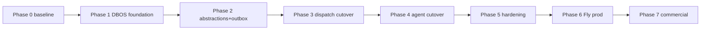

# OpenLevel → TypeScript + DBOS + Fly.io + Neon: Implementation Plan

- **Deliverable for:** `docs/plans/prompt3.md`, as corrected by the final consolidated
  directive in `docs/plans/plan5.md` (§§1–27, controlling on conflict).
- **Checkout:** branch `master`, commit `2634f8c` (full SHA
  `2634f8cd0eaccfdc9d589fad3fc967fd1b3ba0bb`), investigated 2026-11-14.
- **Before-state:** `M .gitignore` (user-directed SDK-clone ignore entry),
  untracked `deepwiki.md` and `docs/plans/`; `docs/architecture/` absent.
- **Method note:** no Node.js toolchain or `node_modules` exists in this
  environment and installation is forbidden, so typecheck/tests could not be
  executed. All test figures are static counts (method stated) and every
  unexecuted check is labeled. No test was modified, skipped, or weakened.
- **Paths** are relative to the git root unless stated otherwise.

## Labels

- **[Verified]** — observed in the checkout or in cited official documentation.
- **[Assumption]** — reasonable default needing confirmation or load testing.
- **[Recommendation]** — the architect's advised choice, with rationale and ADR.
- **[Needs approval]** — business-owner decision; not settled by this document.
- **[Proposed]** — new behavior to build (not present today).

## 1. Executive recommendation

**[Recommendation]** Evolve OpenLevel in place: keep the Hono API, React
frontend, repository layer, PostgreSQL schema shape, provider adapters, and the
full existing test suite; replace the pg-boss execution layer with DBOS
Transact workflows behind the existing `WorkflowDispatch` seam; host one
container image on Fly.io with separate `web` and `worker` process groups; run
application data and DBOS system state on Neon with direct (non-pooled)
connections for the DBOS system database and pooled connections for web
traffic. Start with shared multi-tenancy on the existing `location_id`
boundary, one Neon project, and tenant-partitioned queues — not
database-per-tenant.

Why this shape wins: the current system already isolates orchestration behind
`enqueueAgentReply`/`enqueueWorkflowEvent`/`WorkflowDispatch`
(`server/jobs/boss.ts`, `server/jobs/workflow-dispatcher.ts`), so DBOS can be
introduced as a second executor behind those seams without touching route
contracts. The two durable-execution gaps DBOS actually fixes are real and
verified: `wait` steps die with the process (`setTimeout` + `unref` in
`server/jobs/workflow-runner.ts:52-63`) and every background enqueue is
non-transactional (`boss.send` after persist, no outbox), so a crash between
persist and enqueue silently drops downstream work (worst case:
`server/routes/webhooks-chatwoot.ts:70-99`, where the dedupe guard then
suppresses the retry's enqueue too).

What this plan refuses to promise: exactly-once external delivery from
checkpointing alone (explicit per-operation guarantees in §6/§12 instead);
one-command deployment where Neon provisioning and secrets remain manual;
and any delivery dates. DBOS-only is the starting hypothesis but pg-boss
retention is decided by ADR-1 on workload evidence, not assumed.

Five-question verdict (detail in §§4, 7, 6, 9/13, 15/16): fidelity is
demonstrable via the preserved suite plus the §12 matrix; isolation is
enforceable once tenant context is made an explicit workflow argument;
durability requires the outbox + idempotency design in §6; one-operator
operation is achievable with the Fly/Neon shape in §§9–10 plus §13 runbooks;
early economics work (§16) only with metering and hard caps from day one.

## 2. Verified current architecture

### 2.1 Composition and request path

**[Verified]** `server/index.ts` builds one Hono app (`createApp`, pure and
import-safe) and one bootstrap (`bootstrap()`, lines 239–301) that couples
three responsibilities in a single process: pg Pool → `PgDatabase`, pg-boss
(`startBoss` + two workers), and `serve()` on `config.PORT`. There are 50
non-test route modules and ~230 endpoint registrations (method:
`grep -c 'app.(get|post|put|patch|delete)('`). Route groups:

- Public (no session): `/health`, `/api/auth/*`, `/api/webhooks/chatwoot` (own
  secret), `/api/public/*` (funnels, forms, reviews, courses, blog,
  communities, surveys, proposals, trigger links, booking, pay, voice).
- Operator: `/api/locations` (GET list only), `/api/push-tokens`.
- Tenant: `/api/loc/:loc/*` behind `operatorAuth` then `locationAccess`.
- Federation: `/federation/*` behind its own bearer gate, inert (503) unless
  `FEDERATION_SERVICE_TOKEN` is set.

The dev server (`server/dev-server.ts`) runs the same `createApp` against
in-memory PGlite with stubbed Claude/Chatwoot and in-process dispatch (no
pg-boss), proving the dispatch seam is already executor-agnostic.

### 2.2 Data layer and tenancy as built

**[Verified]** All repository access flows through `Database.query(sql,
params)` (`server/db/database.ts:8-10`) with `PgDatabase` (pg Pool) in prod,
`PgliteDatabase` in dev/tests, and `FakeDatabase` (FIFO queued rows + full
SQL/params recording) in most tests. Tenancy is enforced by convention in
`LocationScopedRepo` (`server/repos/base-repo.ts`): constructor requires a
non-empty `locationId`, reads get `WHERE location_id = $1` injected by regex,
writes carry `locationId` as `$1`. 4 repos are deliberately global:
`OperatorsRepo`, `LocationsRepo`, `ChannelLinksRepo`, `LocationSettingsRepo`.

The schema (`db/schema.sql`, 1096 lines) defines 58 tables, all idempotent
(`CREATE TABLE IF NOT EXISTS` + `ADD COLUMN IF NOT EXISTS`). Tenant-critical
indexes are per-location, not global: `conversations_provider_external` on
`(location_id, provider, external_id)`, `messages_provider_external` likewise
(backing `MessagesRepo.insertInbound`'s `ON CONFLICT DO NOTHING` inbound
dedupe), `contacts_match_key`, and `appointments_no_double_book` (backing the
agent's double-book race guard). Migrations today are a full-file reapply:
`db/migrate.ts` runs the whole `schema.sql` as one `pool.query` — no
versioning, no down migrations, no advisory lock, no per-release ordering.
That is adequate for a single-writer dev database and inadequate for
production: concurrent deploys can interleave DDL, a failed reapply leaves no
record of what applied, and destructive changes (drop/rename) cannot be
expressed at all. **[Proposed]** versioned incremental migrations (§8).

### 2.3 Tenant taxonomy verdict

**[Verified]** The schema contains **no** organization or agency tables
(`grep -in 'organization|agency' db/schema.sql` returns nothing). The
implemented entities are:

| # | Entity | Implementation | Owns |
|---|---|---|---|
| 1 | Organization | **Absent** — no table, no code reference | Nothing (would own cross-location grouping if introduced) |
| 2 | Agency | **Absent as an entity**; `locations.client_slug` is a secret-resolution alias, not a grouping | Nothing directly |
| 3 | SaaS tenant | **De-facto = location** (verdict below) | Billing unit (proposed), quotas, credentials |
| 4 | Location/sub-account | `locations` row (`id`, `slug`, `client_slug`, `branding`, `settings`) | All domain data via `location_id`; reply mode + agent config in `settings` |
| 5 | Individual operator | Global `operators` row; access via `operator_locations` | Nothing directly; membership grants location access |
| 6 | Customer/contact | `contacts` row, location-scoped | Notes, tasks, timeline, conversations |
| 7 | Workflow definition | `workflows` + `workflow_actions` rows | Trigger binding, ordered steps |
| 8 | Workflow execution | `workflow_runs` row (`running`/`waiting`/`completed`/`failed`) | Step log (`steps` jsonb), resume position |
| 9 | DBOS workflow execution | Does not exist yet | **[Proposed]** in §6 |

**Verdict: `location_id` IS the SaaS tenant ID in this codebase** — it is the
sole data boundary, the credential boundary (per-location `channel_links`
plus per-`client_slug` secret names), and the only candidate billing unit.
`client_slug` is a deployment-time alias for secret resolution, not a
separate tenancy layer. No agency/organization grouping exists; introducing
one is a product decision, not a migration requirement. Operator `role`
defaults to `'owner'` but no role check was found in middleware — membership
is binary (403 otherwise).

### 2.4 Auth, secrets, and trust boundaries

**[Verified]** Sessions are stateless HMAC-SHA256 tokens
(`base64url(payload).base64url(hmac)`, `server/lib/session.ts`), 8-hour TTL
(`SESSION_TTL_MS`), constant-time verification, no revocation store; cookie
`ol_session` is `Secure` iff production, and `Authorization: Bearer` is
accepted as an equivalent credential (`server/middleware/auth.ts:12-25`).
Passwords hash with argon2id (`server/lib/password.ts`, `@node-rs/argon2`);
login is rate-limited by an in-memory sliding window
(`server/routes/auth.ts:47`, `server/lib/rate-limit.ts`) that is correct only
for a single process. Auth surface is login/logout/me only — **no
registration endpoint** — and locations expose GET-list only: no
self-service provisioning exists anywhere.

Secrets follow a name-in-DB/value-in-env split: `channel_links.config` and
location settings store secret *names*; `resolveSecret(name)` in
`server/lib/vault.ts:12-15` uppercases and maps them to env vars
(`<SLUG>_<SERVICE>_<KEY>`). There is no `ENCRYPTION_KEY`, no encrypted
column, and no rotation path except redeploying with new env values.
Webhooks authenticate three ways: Chatwoot via shared secret
(header-preferred, `?secret=` fallback, constant-time compare,
`server/routes/webhooks-chatwoot.ts:20-52`); payments via per-location
provider signatures over the raw body (Stripe timestamp tolerance 300s +
multi-`v1` rollover support; Square URL-bound HMAC); federation via a
service bearer plus trusted `X-Federation-Tenant` header set by the gateway
(body tenant IDs are never read).

### 2.5 Domain and integration surface

**[Verified]** 228 non-test TS files under `server/` + `src/` + `db/` +
`scripts/`: 50 routes, ~57 repos, and a large `server/lib/` of pure domain
modules (math/page/vocab per module), provider adapters behind
`provider`/`resolve` pairs for sending (Twilio SMS, Brevo email), payments
(Stripe, Square), voice (Twilio, Vapi), social (Facebook, Instagram,
LinkedIn, X), and reviews (Google, Facebook sync). Locations use their **own**
provider accounts everywhere — OpenLevel relays credentials it never stores
in cleartext. Real-money behavior is strictly bounded: invoices/checkout
links are minted per location, checkout completes on the provider's hosted
page, and `subscriptions`/`products`/`coupons`/`transactions` are
location-level bookkeeping with no charge path (route comments state this
explicitly; no agent tool touches money).

Three request-path fan-outs run synchronously today and matter for worker
sizing: campaign send (`POST /:id/send` → `sendCampaign` loop, 100ms
throttle, suppression tags `unsubscribed`/`dnd`, per-contact isolation),
social publish (`POST /posts/:postId/publish`, 409 unless ≥1 channel
accepts), and call placement. Social *scheduling* only persists
`scheduled_at` — no background publisher exists.

### 2.6 Background execution as built

**[Verified]** Exactly two pg-boss queues exist, both created at boot by
`ensureQueues` (`server/jobs/boss.ts:46-51`) after their DLQs:

- `agent.reply.dispatch` → `handleAgentReply` (payload: location,
  conversation, contact IDs).
- `workflow.dispatch` → `dispatchWorkflowEvent` (payload: location,
  trigger type, contact ID).

Both share `RESILIENT_RETRY` (`retryLimit: 4, retryDelay: 5, retryBackoff:
true, retryDelayMax: 300`, lines 27–32) and `batchSize: 1` (line 38). No
singleton keys, no delayed/scheduled sends, no priorities, no cron — ordering
and dedup are entirely absent at the queue layer. Dispatch producers are the
Chatwoot `onInbound` hook (both queues), six public routes + opportunities
(workflow events for all 7 trigger types), and the agent's booking tool
(`appointment_booked`).

Execution semantics that constrain the migration:

1. **Workflow SMS/email never sends.** `executeAction` renders merge fields
   and writes a `timeline` row with `status: 'logged'`
   (`server/jobs/workflow-runner.ts:116-137`); carrier wiring is an explicit
   TODO. Only `add_tag` mutates. Duplicate workflow runs today duplicate
   tags/timeline rows, not messages.
2. **Waits die with the process.** `defaultSchedule` uses chunked `setTimeout`
   with `unref()` (lines 52–63); resume via `runId + fromPosition` works only
   if the process survives.
3. **Agent sends are send-then-persist.** `sendOutboundMessage`
   (`server/lib/outbound.ts:62-88`) POSTs to Chatwoot (no idempotency key,
   `server/lib/chatwoot-client.ts:15-31`) *before* inserting the message row:
   crash in between means sent-but-unrecorded, and the pg-boss retry sends
   again. Approve-first mode (the default) instead persists a `draft` and
   never sends.
4. **Enqueue is not transactional.** Every `boss.send` happens after the
   triggering persist with no outbox. The sharpest edge: Chatwoot inbound
   dedupes on `(location_id, provider, external_id)` and returns before
   `onInbound` on a duplicate — so a first attempt that persists the message
   but fails to enqueue will, on provider retry, answer `deduped: true`
   without ever enqueueing the agent reply or workflow event.
5. **Agent tools are already least-privilege**: 2 read + 2 write tools,
   contact-pinned, location-scoped, write-gated twice (schema withholding +
   dispatcher refusal), bounded to 5 tool rounds + forced-text final round
   (`server/lib/agent-tools.ts`, `server/lib/agent-runner.ts:60-92`).
   `book_appointment` converts unique violations into honest "taken" errors.

### 2.7 pg-boss fifteen-field inventory (both queues, all **[Verified]**)

| # | Field | `agent.reply.dispatch` | `workflow.dispatch` |
|---|---|---|---|
| 1 | Job name | `agent.reply.dispatch` (+ DLQ `agent.reply.dead`) | `workflow.dispatch` (+ DLQ `workflow.dispatch.dead`) |
| 2 | Trigger | `boss.send` from Chatwoot `onInbound` | `boss.send` from 7 producers (6 public routes + opportunities + agent tool + `onInbound`) |
| 3 | Payload | `{ locationId, conversationId, contactId \| null }` | `{ locationId, triggerType, contactId \| null }` |
| 4 | Tenant/location context | `locationId`, re-resolved via `LocationsRepo.getById` | `locationId`, used to scope all run repos |
| 5 | Retry behavior | `retryLimit: 4` (1 try + 4 retries) | Same |
| 6 | Backoff | `retryDelay: 5`, `retryBackoff: true`, `retryDelayMax: 300` | Same |
| 7 | Concurrency | pg-boss defaults (not configured in code) | Same; runs within one dispatch execute sequentially |
| 8 | Ordering | None guaranteed | None across events; sequential per dispatch job |
| 9 | Singleton/dedup | None (no keys passed to `send`) | None |
| 10 | Delay/scheduling | None (no delayed sends, no cron) | None |
| 11 | Failure handling | Throw → retry → DLQ copy; expected dead-ends return `skipped` (no retry burn) | Same; missing workflow throws synchronously on fresh runs |
| 12 | Dead-letter behavior | Payload preserved in `agent.reply.dead` for inspect/requeue | Same in `workflow.dispatch.dead` |
| 13 | Idempotency assumptions | None at queue layer; handler-level `skipped` guards only | None; re-dispatch re-runs (tags/timeline rows duplicate) |
| 14 | Txn boundaries | None spanning enqueue→execute; handler does sequential queries, no explicit transaction | Same |
| 15 | Run state/resumption | No run record (result returned, not stored) | `workflow_runs` rows; resume via `runId + fromPosition` if process survives |

## 3. Repository and test inventory

### 3.1 Counts (all recounted 2026-11-14; method stated)

| Measure | Value | Method |
|---|---|---|
| Non-test TS files (`server`+`src`+`db`+`scripts`) | 228 | `find … -name '*.ts' -not -name '*.test.ts' \| wc -l` |
| Test files | 182 | `find … -name '*.test.ts' \| wc -l` |
| Test cases (approx) | ~1622 | `grep -rhoE '(it\|test)\('` — static, may include helpers |
| Skipped/todo | 0 files | `grep -rl '(it\|test).(skip\|todo)'` + `describe.skip` |
| Route modules / endpoint registrations | 50 / ~230 | `ls` + `grep -c 'app.(get\|post\|…)'` |
| Schema tables | 58 | `grep -c 'CREATE TABLE' db/schema.sql` |

Test files by subsystem: `server/` 1, `server/db` 1, `server/jobs` 4,
`server/lib` 72 (incl. payments 3, reviews 4, sending 4, social 6, voice 3),
`server/middleware` 2, `server/repos` 53, `server/routes` 49, `scripts/` 0.

### 3.2 Tiers and execution status

**[Verified]** Three tiers exist, zero tests touch real Postgres
(`grep -rln 'new Pool(|PgDatabase(' … --include='*.test.ts'` is empty):

- **Fake-DB tests (102 files import `fake-database`).** `FakeDatabase`
  returns FIFO-queued rows and records every SQL/params pair; route and repo
  tests assert tenancy structurally (e.g. `contacts.test.ts` requires
  `params[0] === 'locA'`). Fast, deterministic, and the reason tenant
  scoping is provable without a database.
- **PGlite integration tests (20 files).** Each spins a fresh in-process
  WASM Postgres and loads the full `schema.sql` in a per-file `setup()`
  (public routes, jobs dispatch/runner, a few repos). The 30s
  `testTimeout` in `vitest.config.ts` exists specifically for PGlite
  cold starts.
- **Pure unit tests.** Domain math/vocab/adapter tests with injected
  `fetchImpl` and clocks; no DB at all.

**[Verified] Execution: NOT RUN.** `node`, `npm`, and `node_modules` are all
absent (PATH + `/usr/local/bin`, `/opt/homebrew/bin`, `~/.nvm`,
`~/.volta` probed) and installation is forbidden, so `typecheck` and `test`
from `package.json` scripts could not be executed. Pass/fail counts,
runtime, and flake behavior are therefore **unknown, not zero** — the
migration's Phase 0 must capture them on a provisioned machine before any
other work. No test file was read for modification; none was altered.

### 3.3 Coverage gaps

**[Verified]** No tests exist for: the React frontend (`src/`, no test
runner configured), the Expo app (`openconnector/`, separate package),
`scripts/`, session revocation (no such feature), pg-boss failure injection
(workers are tested through handler functions, not a live boss), and
multi-process behavior (rate limiter, wait timers). Authz coverage is
structural (middleware + param assertions) rather than adversarial: no test
attempts cross-tenant forgery beyond asserting the `location_id` param.
These gaps shape §12: the DBOS resilience tier must be genuinely new, while
all 182 existing files stay intact and passing.

## 4. Behavioral compatibility requirements

Everything in this section is **[Verified]** current behavior that the new
system must preserve, with the exact mechanism that observes it.

1. **HTTP contracts.** All ~230 endpoints keep paths, methods, status codes,
   and Zod-validated shapes. The frontend (`src/`) and Expo app
   (`openconnector/`) are API consumers with no versioning layer — any
   contract break is a user-visible break. Verified by the 49 fake-DB route
   test files plus the 20 PGlite integration files.
2. **Tenant scoping.** Every location query filters `location_id = $1` with
   the location bound at repo construction; cross-location reads are 404s,
   non-member access is 403. Verified structurally today; must additionally
   survive as a runtime property inside workflows (§7).
3. **Reply-mode default.** Unknown/absent `replyMode` → `approve-first`
   (draft persisted, never sent). Only explicit `'autonomous'` sends.
   (`server/jobs/agent-reply.ts:67-68`.)
4. **Workflow action semantics.** `send_sms`/`send_email` = merge-render +
   timeline `logged` row (no carrier side effect); `add_tag` = real tag;
   unknown actions = `skipped`, never failure. Carrier wiring later must be
   a deliberate, reviewed behavior change with new acceptance tests — not a
   silent side effect of the DBOS port.
5. **Wait/run-state reuse.** Existing `workflow_runs` rows (statuses,
   `steps` jsonb, `finished_at`) remain readable; in-flight `waiting` runs
   at cutover are drained by the old runner (§11), never reinterpreted by
   the new one. New DBOS executions write new run records; history is
   append-only.
6. **Agent tool contract.** Same 4 tools, same schemas, same write gate,
   same 5-round bound, same forced-text fallback; `book_appointment` keeps
   its slot-match + unique-violation honesty. Model ID (`DRAFT_MODEL`) may
   change only with a product decision, not as migration fallout.
7. **Webhook honesty.** Chatwoot dedupe (`deduped: true`), payments
   paid-guard (`deduped: true`) and unknown-invoice 200-ignore, Stripe
   300s replay tolerance — all preserved. The lost-enqueue edge (§2.6.4) is
   the one behavior that **must change**: acknowledged business events must
   never silently lose downstream processing (§6 outbox design).
8. **Money boundaries.** No new charge/refund/send-money path may appear in
   the port. The agent keeps zero payment tools; checkout stays
   provider-hosted; bookkeeping stays bookkeeping.
9. **Public-route openness.** Booking, funnels, forms, surveys, proposals,
   trigger links, and payment/voice webhooks stay unauthenticated by
   design; their abuse surface (no rate limit today) must not widen —
   §14 adds limits without changing happy-path contracts.
10. **Failure honesty.** `skipped` results (no location, no key, no
    contact), per-contact campaign isolation, and publish-409 semantics are
    contractual UX, not incidental logs. DBOS retries must reproduce the
    same terminal outcomes a pg-boss retry sequence produces today.

## 5. Target architecture

**[Recommendation]** One container image, two Fly process groups (`web`,
`worker`), one Neon project. The web group serves Hono only and never runs
workflow code; the worker group runs DBOS (`launch()` + recovery) and never
serves public traffic. Both share the workflow *definitions* (same image,
same registry code) and coordinate through the DBOS system database.

```mermaid
flowchart LR
  subgraph Client["Clients"]
    SPA["React SPA"]
    MOB["Expo app"]
    CH["Chatwoot"]
    PAY["Stripe / Square"]
  end
  subgraph Fly["Fly app (one image)"]
    WEB["web group\nHono API\nDBOS.launch for enqueue"]
    WRK["worker group\nDBOS executor\n+ recovery + scheduler"]
  end
  subgraph Neon["Neon project"]
    APP[("app schema\n(domain tables)")]
    SYS[("dbos schema\n(system tables)")]
  end
  SPA --> WEB
  MOB --> WEB
  CH --> WEB
  PAY --> WEB
  WEB -->|direct + pooled| APP
  WEB -->|enqueue (direct)| SYS
  WRK -->|direct only| APP
  WRK -->|direct only| SYS
  WRK -->|provider calls| CH
```

Request flow: web authenticates → resolves tenant → persists business rows
**and** an outbox row in one transaction → returns. A DBOS-scheduled
pump (or Postgres `LISTEN` on the direct connection) starts the durable
workflow with a stable ID derived from the outbox row. Worker flow:
partitioned queues (partition key = `location_id`) execute agent-reply and
automation workflows; each external call lives in a step with explicit retry
policy and a per-operation guarantee from §6.

Why web still calls `DBOS.launch()`: the TS SDK requires launch before any
`startWorkflow`/enqueue call from a process (verified in SDK source,
`DBOS.launch` at `src/dbos.ts:687` in the reference clone at commit
`e94db66`), and launch runs recovery — which is safe on web because recovery
only resumes workflows onto executors of a matching application version
([Upgrading Workflow Code](https://docs.dbos.dev/typescript/tutorials/upgrading-workflows)).
Web therefore launches with dequeue effectively disabled (no queue workers
registered there) while worker launches with the full executor. This is the
topology §7 of the directive requires to be doc-supported before
recommending: queue dequeue happens on processes running queue workers, and
version pinning keeps in-flight executions on compatible code during
deploys.

## 6. DBOS workflow mapping

### 6.1 Design rules (apply to every workflow)

**[Recommendation]**

1. **Thin workflows, fat domain modules.** Workflows orchestrate; all
   business logic stays in the existing `server/lib` modules and repos,
   called from steps. No repo is rewritten against DBOS transactions in
   Phase 1 — steps call `Database.query` through the same interfaces, so
   the 102 fake-DB test files keep passing unmodified.
2. **IDs, not records, cross the workflow boundary.** Workflow arguments
   carry `{ locationId, contactId?, conversationId?, runId?, idempotencyKey
   }` plus trigger metadata — never full rows, never secrets. Secrets
   resolve inside steps via the existing vault seam.
3. **Stable workflow IDs.** Every enqueue derives its `workflowUUID` from
   the business key (`outbox row id`, `message id`, `event id`), so a
   retried enqueue is a no-op rather than a duplicate execution. Queue
   `deduplicationID` is set to the same key with `return-existing`
   collision behavior (verified in SDK source, `src/workflow.ts:59`,
   `src/enqueue_options.ts:44-45`).
4. **One outbox.** All request-path triggers (webhooks, public routes,
   operator routes, agent tools) insert an `outbox` row in the same
   transaction as their business write. A DBOS scheduled pump
   (`DBOS.registerScheduled`, crontab syntax — verified in the
   [SDK README](https://github.com/dbos-inc/dbos-transact-ts)) claims
   due rows (`FOR UPDATE SKIP LOCKED`) and starts workflows. This closes
   the §2.6.4 lost-enqueue hole: persistence and intent are atomic.
5. **Retries mirror today's terminal behavior.** Step retry defaults
   reproduce `RESILIENT_RETRY` (maxAttempts 5 total tries ≈ retryLimit 4
   retries, `intervalSeconds: 5`, `backoffRate: 2`, capped): SDK step
   options verified in `src/step.ts:11-15` (`intervalSeconds`,
   `maxAttempts`, `backoffRate` default 2). Poison handling: after
   exhaustion the workflow transitions to a `failed` run record + DLQ
   row, never silent drop — matching today's DLQ preservation.
6. **Nondeterminism lives in steps.** Time (`now()`), IDs (`nanoid()`),
   DB I/O, HTTP, config/secret lookups, and model responses all execute
   inside steps or transactions so replay reuses checkpoints instead of
   re-executing them. `DBOS.sleep` (durable; wakeup stored in Postgres —
   [reference](https://docs.dbos.dev/typescript/reference/methods))
   replaces every `setTimeout` wait.

### 6.2 Workload mapping (all 13)

| # | Workload (current) | DBOS design | Queue / partition | Idempotency | Failure handling |
|---|---|---|---|---|---|
| 1 | Agent reply (`handleAgentReply`) | `agentReplyWF`: step 1 load location+mode; step 2 `generateAgentText` (tools inside); step 3a autonomous `sendOutboundMessage`, 3b approve-first draft persist | `agent` queue, partition `locationId`, partitionConcurrency 2 **[Assumption]** | workflowUUID `agent:{messageId}`; Chatwoot send guarded by sent-marker row written in the same step *before* the POST returns... see §6.3 | Model 429/529 → step retry w/ backoff; skipped modes → clean completion (no retry burn) |
| 2 | Workflow event dispatch (`dispatchWorkflowEvent`) | `dispatchWF`: step loads live workflows for trigger, then starts one `automationWF` per match (child-style fan-out), sequentially as today | `dispatch` queue, partition `locationId` | workflowUUID `evt:{outboxRowId}`; dedup ID same | Missing workflow → failed run record, not throw |
| 3 | Workflow execution + resumption (`runWorkflow`) | `automationWF`: one step per action; run state = `workflow_runs` rows as today (append-only, same statuses) | inherits dispatch partition | workflowUUID `run:{runId}`; resume = recovery, not re-enqueue | Unknown action → `skipped` step (preserved) |
| 4 | Long waits (`wait` action) | `DBOS.sleep(waitMs)` inside `automationWF`, then continue | sleeping workflows consume no worker slot while parked **[Assumption** re memory — verify; wakeup is DB-recorded per docs] | wakeup time checkpointed; replays never double-advance | Survives restarts, deploys, Machine replacement, scaling, DB outage (recovery on reconnect) |
| 5 | Scheduled/recurring (none today) | `DBOS.registerScheduled` crontabs: outbox pump (every 5s), nightly analytics, DLQ sweeper, social due-publisher | `system` queue, unpartitioned, concurrency 1 per schedule | Scheduled workflows run exactly-once per interval per SDK docs; pump claims rows idempotently | Missed ticks on total outage → catch-up by schedule, never backfill storms (concurrency 1) |
| 6 | Inbound webhooks (Chatwoot) | Webhook persists message + outbox row transactionally; pump starts `agentReplyWF` + `dispatchWF` | n/a (request path) + §6.1.4 | Provider dedupe index unchanged; outbox row id is the stable key | OnInbound failure can no longer orphan work: the outbox row exists regardless |
| 7 | Outbound messaging (Chatwoot composer) | Operator composer stays synchronous (UX), but inserts the message as `sending` first; a `confirmSendWF` reconciles provider state | `reconcile` queue | Sent-marker + provider `externalId` recorded; reconcile replays uncertain sends by lookup, not resend | Uncertain outcomes land in the admin reconcile view (§13), never auto-duplicated |
| 8 | Appointment booking (public + agent tool) | Booking stays request-path (unique index is the guard); workflow event via outbox | n/a + dispatch queue | `appointments_no_double_book` unchanged | Double-submit → honest "taken" as today |
| 9 | Cancellation/failure | `cancelWF`: marks `workflow_runs` + DBOS cancellation handle; failure closes runs `failed` with Terminal detail | same as target workflow | Cancellation is idempotent by run id | Cancel-after-complete is a no-op success |
| 10 | DLQ inspect/replay | DLQ rows (existing `*.dead` queues migrate to a `dead_letters` table, §11) replayed by re-enqueue with the *original* workflowUUID | admin-triggered, `system` queue | Original UUID → re-execution resumes from last checkpoint, never duplicates completed steps | Replay requires operator role + reason (audit-logged) |
| 11 | CSV imports (new surface) | `importWF` parent + chunked child workflows (1k rows each); progress in a import-jobs table | `bulk` queue, partition `locationId`, partitionConcurrency 1 | Chunk workflowUUID `import:{jobId}:{chunk}`; row upserts by `match_key` | Per-chunk retry; job resumable; see ADR-1 economics |
| 12 | Nightly analytics (new surface) | Scheduled `analyticsWF` per tenant, sequential tenants | `system` queue, partition `locationId`, partitionConcurrency 1 | workflowUUID `analytics:{locationId}:{date}` | Per-tenant failure isolated; digest notes the gap honestly |
| 13 | Other discovered jobs | Push fan-out (`notifyPush`, fire-and-forget today) → `pushWF` with bounded retry; review sync → scheduled; social due-publish → scheduled | `bulk`/`system` as fits | Same stable-ID rule | Fire-and-forget becomes at-least-once with honest failure rows |

### 6.3 External side effects: the 12 + 2 analysis

DBOS recovers workflows "from the last completed step" ([Workflows](https://docs.dbos.dev/python/tutorials/workflow-tutorial)),
which means an interrupted step re-executes: at-least-once at the step
level. Checkpointing alone therefore never guarantees exactly-once delivery
to Chatwoot, Twilio, Stripe, or any provider. Every important operation was
checked against the 12 original considerations (provider idempotency,
stable operation IDs, outbox, callback reconciliation, duplicate webhooks,
duplicate enqueues, uncertain timeouts, DB txn failure, poison messages,
retry classification, DLQ recovery, manual intervention) plus 2 additions:
**(13)** crash after provider success but before checkpoint, and
**(14)** application-level deduplication.

| Operation (current code) | Guarantee **[Recommendation]** | Mechanism |
|---|---|---|
| Chatwoot outbound send (`sendOutboundMessage`) | Application-level dedup + reconcile | Sent-marker row (`pending`→`sent`+`externalId`) in the same step; uncertain outcomes resolved by provider lookup in `confirmSendWF`, surfaced in admin view; never blind resend |
| Twilio SMS (`twilio-adapter`, no idempotency key today) | Outbox + reconcile | Per-recipient send records; Twilio message SIDs reconciled via status callbacks (`webhooks-voice`); duplicates on uncertain timeout are possible → documented, metered, admin-visible |
| Brevo email (no idempotency key today) | Outbox + best-effort retry | Same record pattern; provider `messageId` stored; no resend without operator action after first attempt succeeds-uncertain |
| Stripe checkout sessions (no `Idempotency-Key` header today) | Provider-enforced **[Proposed]** | Add stable `Idempotency-Key: ol-invoice-{id}` header — Stripe supports this natively; verify in Stripe docs at implementation |
| Square payment links (`idempotency_key` with random suffix today — defeats retries) | Provider-enforced **[Proposed]** | Stabilize to `ol-{invoiceId}` (drop the `nanoid(8)`); verified current code at `square-adapter.ts:45` |
| Anthropic completions | Best-effort retry | Duplicate completions waste money, not correctness; bound by 5-round cap + per-tenant AI budgets (§16); no side effect to dedupe |
| Agent booking / tagging | Application-level dedup | Unique index + pinned IDs make re-execution converge to the same state; double-book → honest "taken" |
| Social publish (multi-target, partial success today) | Outbox + reconcile | Per-target outcome rows already recorded; republish only `failed` targets, never `published` ones |
| Voice calls (`calls` route) | Manual recovery first | Call placement is real-time and operator-initiated; no auto-retry of uncertain placements; status mirrored from provider callbacks |

Retry classification rule: 429/529/timeout/network → retry with backoff;
4xx-validation/auth → no retry, fail fast to DLQ with classified error;
uncertain-timeout-after-POST → exactly one reconcile path, never an
automatic second POST. Poison messages (3 consecutive same-step failures
with identical input hash) short-circuit to DLQ with the input preserved.

The five recovery-guarantee categories (exactly one per operation):
(1) provider-enforced idempotency; (2) application-level deduplication;
(3) transactional outbox plus reconciliation; (4) best-effort retry;
(5) manual recovery.

## 7. Tenant isolation design

### 7.1 Boundary and trusted source

**[Recommendation]** The tenant is the `location_id` (§2.3 verdict). The
trusted tenant-identity source differs by entry point and is never an
untrusted body field:

- Operator HTTP: `locationAccess` middleware (membership-checked) sets
  `locationId`; workflows inherit it as a required argument.
- Public HTTP: location resolved from URL slugs/links server-side
  (funnel/form/survey/proposal/booking routes), never from client claims.
- Chatwoot webhook: `ChannelLinksRepo.resolveLocation(inboxId)` maps the
  authenticated inbox to exactly one location.
- Payments/voice webhooks: `:locationId` URL param + per-location
  signature verification — the signature is what binds param to tenant.
- Federation: bearer match, then trusted `X-Federation-Tenant` header.
- Workflows/retries/scheduled runs: `locationId` is a mandatory,
  validated workflow argument re-checked against the triggering row
  (message/outbox/run) at step 1; a mismatch fails closed.

### 7.2 Fourteen-point trace (loss/forge/confuse/leak audit)

**[Verified]** current handling → **[Proposed]** hardening:

1. **Authentication** — verified: HMAC session + argon2 passwords; no
   change except multi-process-safe login limiting (§14).
2. **HTTP authorization** — verified: membership check per request.
3. **Middleware** — verified: `operatorId`/`locationId` set only by the
   two guards; routes cannot self-assert tenancy.
4. **Repository access** — verified: constructor-bound `locationId`;
   risk: the 4 global repos + any direct `db.query` bypass. **[Proposed]**
   a lint rule + test asserting every `new XRepo(` passes a validated
   `locationId`, and a `TenantContext` carrier object (not a bare
   string) in workflow code so the type system tracks it.
5. **SQL transactions** — verified: params carry `$1 = locationId` even
   in hand-written SQL (e.g. `conversations.touch`). No change.
6. **Job payloads** — verified: all three payload shapes carry
   `locationId`. **[Proposed]** outbox rows carry it too, FK'd to
   `locations`.
7. **Workflow arguments** — new: required `locationId`, validated at
   step 1 against the source row; mismatch → fail closed, alert.
8. **Workflow steps** — new: steps receive the validated context object,
   never re-derive tenancy from nested payloads.
9. **Retries and recovery** — new: recovery replays with the *original*
   arguments; DBOS checkpoints include them, so a retry cannot "drift"
   tenants. Acceptance test: kill -9 mid-step, assert resumed execution
   queries carry the same `location_id`.
10. **Delayed execution** — new: sleeping workflows persist arguments in
    the system DB; wakeup re-validates location existence (deleted
    location → honest `failed`, mirroring today's deleted-workflow
    handling in `runWorkflow`).
11. **Scheduled execution** — new: per-tenant schedules embed
    `locationId` at creation from an authenticated context; the pump
    never accepts tenant IDs from schedule payloads alone.
12. **Inbound webhooks** — verified: inbox→location and signature-bound
    params (above). Kept.
13. **Agent tools** — verified: contact-pinned + write-gated (§2.6.5).
    **[Proposed]** additionally pass an execution-bound context so a
    resumed agent turn cannot act if the conversation's contact changed
    tenants (defensive; no such reassignment exists today).
14. **Provider callbacks** — verified: payment/voice callbacks resolve
    tenant before acting. Chatwoot *outbound* has no callback today:
    **[Proposed]** the §6.3 sent-marker + reconcile design, so a
    retried send cannot leak one tenant's message into another tenant's
    conversation (guarded by the per-tenant external-id indexes).

### 7.3 Fairness controls

**[Recommendation]** Partitioned queues with partition key `locationId`
(partitioning verified: a queue is partitioned when registered with any
per-partition limit —
[Queues & Concurrency](https://docs.dbos.dev/typescript/tutorials/queue-tutorial)).
Initial values **[Assumption — load-test before production]**:
`agent` queue global concurrency 20, `partitionConcurrency` 2,
`partitionRateLimit` 30/min; `dispatch` global 50, partition 5;
`bulk` global 4, partition 1; `system` concurrency 1 per schedule.
Rationale: agent turns are the expensive operation (model latency +
tokens); 2 concurrent turns per tenant keeps interactive latency sane
while 20 global bounds cost. DB connection budget (§8) is sized so the
queue ceilings cannot exhaust it. Quotas and hard caps (§16) sit above
queues as the billing enforcement layer.

## 8. Neon database architecture

### 8.1 Placement decision

**[Recommendation]** Option 1: separate schemas (`app`, `dbos`) in the
same Neon database, in one Neon project. Trade-offs: option 1 keeps one
connection endpoint, one backup/PITR timeline (app + system state restore
together — critical for §14 consistency), and zero cross-database
transaction loss; its cost is shared fate on noisy-neighbor I/O and a
single `max_connections` pool, both acceptable at launch scale with the
budget below. Option 2 (separate databases, same project) splits timelines
and doubles connection management for no isolation gain (same project
admins). Option 3 (separate projects) is the premium-tier upgrade path
(§15), not the starting point. [Needs approval] if a launch customer
requires data-residency separation.

### 8.2 Connection architecture

**[Verified]** DBOS's production guidance requires direct connections or a
*session-mode* pooler, explicitly forbidding transaction-mode poolers
([Production Checklist](https://docs.dbos.dev/production/checklist)).
Neon's `-pooler` endpoint is transaction-mode PgBouncer (up to 10k client
connections;
[Neon pooling](https://neon.com/faqs/enable-disable-connection-pooling-neon)).
Therefore:

- `DBOS_SYSTEM_DATABASE_URL` → **direct** hostname, used by web (enqueue)
  and worker (execute/recover). Never pooled.
- `DATABASE_URL` (app reads/writes on web) → **pooled** hostname for
  elasticity under request bursts.
- `DATABASE_URL_DIRECT` → direct hostname for worker steps (long-lived
  transactions, `LISTEN` for the outbox pump fallback), migrations
  (`release_command`), and admin.

Connection budget **[Assumption — verify against Neon plan limits]** for
1 web + 2 worker Machines: web pool 10 (pooled endpoint), each worker 15
direct (queue ceilings from §7.3 bound concurrent step transactions well
under this), migration 2, admin 3, headroom ~10 → ~55 direct backends.
Neon compute sizing starts at the smallest tier that serves this with
autoscaling room; scale-to-zero stays **off** for production (cold starts
would stall the outbox pump and health checks).

### 8.3 Roles, migrations, branching, backup

**[Recommendation]** Least-privilege roles: `app_web` (DML on `app`
schema only), `app_worker` (DML on `app` + execute on `dbos` schema),
`migrator` (DDL, used only by `release_command` and `dbosctl sysdb
migrate`), `readonly` (admin/metrics). DBOS system tables are created by
`dbosctl sysdb migrate` (privileged, per the production checklist above),
run from `release_command` **before** app migrations; app migrations run
after, under advisory lock, from a new versioned `db/migrations/`
directory that supersedes full-file reapply (existing `schema.sql` becomes
the `V1` baseline import). Rollback: forward-fix preferred; destructive
migrations require the expand/contract pattern with a recorded backout
migration — never `dbos` schema surgery by hand.

Neon branches: `production` (root, PITR-enabled), ephemeral branches for
preview/test restores, and one long-lived `staging` branch for migration
rehearsal. PITR is branch-based instant restore on root branches
([Neon PITR](https://neon.com/blog/point-in-time-recovery-in-postgres));
paid history retention is 7 days default (Launch) with history storage
billed per GB-month — RPO/RTO candidates in §14. Every release rehearses
migration + `dbosctl` ordering on a fresh branch; restores are tested
quarterly, not assumed.

## 9. Fly.io deployment architecture

### 9.1 Configuration decision

**[Recommendation]** Option B: one image, two process groups (`web`,
`worker`). The verified coupling it fixes: today one process serves HTTP
*and* runs both pg-boss workers (`bootstrap()`), so an automation storm
can starve request handling. Rejected alternative A (combined) keeps that
fate-sharing and complicates independent scaling; it remains the valid
fallback if DBOS topology verification ever fails (it did not — §5).

- `web`: `min_machines_running = 1`, `auto_stop_machines = "stop"`,
  `auto_start_machines = true` under `[http_service]`; HTTP checks on
  `/health` (exists today, `server/index.ts:107`) every 15s. Autostop is
  safe for web because start-on-request restores serving in seconds and
  no durable work lives there.
- `worker`: `min_machines_running = 1` (never scale to zero — a stopped
  fleet silently delays all background work), autostop **off**;
  no public service; TCP check on an internal admin port + a
  DBOS-heartbeat check (last successful queue poll timestamp).
  Start/stop semantics verified:
  [App Availability](https://docs.fly.io/apps/app-availability).

Sizing **[Assumption]**: web `shared-cpu-1x` 512MB; worker
`shared-cpu-2x` 1GB (agent turns hold model responses + tool state in
memory). Regions: primary near Neon region; no multi-region until a
customer pays for it.

### 9.2 Lifecycle, shutdown, and deployment

Deploy strategy: rolling with `release_command` running migrations in a
throwaway Machine on the new image *before* any Machine updates; non-zero
exit stops the deploy ([Fly release semantics](https://fly.io/web-app-with-postgres/)).
`release_command` order: (1) `dbosctl sysdb migrate`, (2) app migrations
under advisory lock, (3) version-compatibility assertion (new code's
`application_version` registered; old version retained per §6 versioning).
Graceful shutdown: SIGTERM → stop dequeueing → await in-flight steps up
to `shutdownTimeout` → `DBOS.shutdown()`; unfinished workflows recover on
the surviving worker via matching-version recovery
([Upgrading Workflow Code](https://docs.dbos.dev/typescript/tutorials/upgrading-workflows)).
Blue-green for breaking workflow changes: pin `application_version` per
deploy, keep old workers until old-version workflows drain, then promote
latest. Rollback: redeploy prior image (prior version resumes its
workflows); DB rollback only via recorded backout migrations — application
downgrades never run against a newer app schema without one.

## 10. Dockerfile and fly.toml design

### 10.1 Build

**[Recommendation]** Multi-stage Dockerfile on Node 22 (repo requires
`>=22.0.0`): (1) `deps` — `npm ci` from the committed lockfile;
(2) `webapp` — `vite build` for the SPA into `dist/`; (3) `runtime` —
production `node_modules` + TS sources executed via `tsx` **without
bundling the DBOS workflow registry** (decorators + class identity must
survive; never Vite/esbuild/rollup-bundle `server/dbos/`), SPA served as
static files by the web process. Entrypoints: `node server/boot-web.mjs`
(web: `DBOS.launch()` for enqueue + recovery-safety, `serve()` for HTTP —
no queue workers registered there, so web never dequeues) and `node
server/boot-worker.mjs` (worker: full `DBOS.launch()` + queue workers, no
listen socket). One image, `CMD` selected per process group. No native
toolchain needed (`@node-rs/argon2` ships prebuilt).

### 10.2 fly.toml sketch

```toml
app = "openlevel"
primary_region = "iad"  # [Assumption] co-locate with Neon region

[build]
  dockerfile = "Dockerfile"

[deploy]
  release_command = "node scripts/release.mjs"  # dbosctl → app migrate → version assert

[processes]
  web = "node server/boot-web.mjs"
  worker = "node server/boot-worker.mjs"

[http_service]
  internal_port = 8790
  force_https = true
  auto_stop_machines = "stop"
  auto_start_machines = true
  min_machines_running = 1
  processes = ["web"]

  [[http_service.checks]]
    grace_period = "15s"
    interval = "15s"
    method = "GET"
    path = "/health"
    timeout = "5s"

[[vm]]
  cpu_kind = "shared"
  cpus = 1
  memory_mb = 512
  processes = ["web"]

[[vm]]
  cpu_kind = "shared"
  cpus = 2
  memory_mb = 1024
  processes = ["worker"]

[metrics]
  port = 9091
  path = "/metrics"
```

Worker has no `[[services]]` block: unreachable from the public internet;
Fly-internal TCP check on the admin port only. Secrets (Appendix A) are
set once via `fly secrets set` and never baked into the image.

## 11. Migration and cutover strategy



### 11.1 Phases with completion criteria

- **Phase 0 — Baseline.** Capture executed typecheck/test results on a
  provisioned machine; freeze the §3 inventory; stand up Neon staging +
  Fly staging app. *Done when:* green baseline recorded, staging deploy
  works end-to-end on pg-boss.
- **Phase 1 — DBOS foundation.** Add `@dbos-inc/dbos-sdk`, `server/dbos/`
  registry, system DB via `dbosctl`, one vertical slice (outbox pump →
  no-op workflow → DLQ view) on staging. *Done when:* slice recovers
  from `kill -9` and the 18 §12 scenarios have harness coverage.
- **Phase 2 — Abstractions + outbox.** Route all producers through the
  outbox (dual-write: outbox row + legacy `boss.send`, outbox authoritative
  for new code paths); stabilize Square/Stripe idempotency keys. *Done
  when:* every producer writes outbox rows and legacy behavior is
  byte-identical (existing suite green).
- **Phase 3 — Dispatch cutover.** `dispatchWF`/`automationWF` take over
  per-tenant behind a location flag; pg-boss dispatch drained then
  disabled per tenant. *Done when:* zero `workflow.dispatch` jobs for 7
  days with parity metrics clean.
- **Phase 4 — Agent cutover.** Same per-tenant flag for `agentReplyWF`
  with sent-marker reconciliation. *Done when:* zero `agent.reply`
  jobs for 7 days, duplicate-send rate zero.
- **Phase 5 — Hardening.** Metrics/alerts (§13), DLQ admin, quotas,
  reconcile view, runbooks drilled on staging.
- **Phase 6 — Fly production.** Cut DNS/traffic; pg-boss code paths
  removed (ADR-1 permitting); blue-green drill executed once for real.
- **Phase 7 — Commercial.** Registration/provisioning/billing/metering
  (§15) behind plan gates.

Per-phase rollback: Phase 0 — delete staging resources. Phase 1 — drop
`dbos` schema + SDK (no prod traffic touched). Phase 2 — stop outbox
writes (legacy `boss.send` path remains primary throughout). Phase 3/4 —
per-tenant flag flip back to pg-boss (drain rows already claimed by DBOS
finish there; mutual exclusion prevents double execution). Phase 5 —
disable new surfaces (flags off). Phase 6 — redeploy prior image + prior
`application_version`; DB backout only via recorded migrations, never by
downgrading against a newer schema. Phase 7 — plan gates off; billing in
trial mode until proven.

Freeze/drain/migrate/verify/reactivate (per tenant, Phases 3–4):
**freeze** new pg-boss sends for the execution type; **drain** active +
pending + retrying jobs to success or DLQ (bounded wait, then operator
decision); **migrate** DLQ/export rows + flip the cutover flag;
**verify** parity metrics for 24h (run counts, terminal outcomes,
duplicate-send rate zero); **reactivate** by enabling DBOS enqueue for
the tenant. Rollback reverses the flag at any point before old-runner
removal; already-started DBOS executions are never translated back —
they finish under DBOS while new work returns to pg-boss.

### 11.2 Eleven-item compatibility matrix

Mapping (existing → DBOS) is recorded separately from the five fields
(strategy, compatibility, cutover, recovery, rollback):

| # | Item | Mapping | Strategy / cutover / rollback |
|---|---|---|---|
| 1 | Pending jobs | Re-read from pg-boss tables at flag-flip; equivalent outbox rows inserted once (guarded by `source='pgboss-drain'` unique key) | Drain-then-disable per tenant; rollback = re-enable boss worker, delete unclaimed drain rows |
| 2 | Running jobs | Let finish on pg-boss (bounded by step timeouts); DBOS takes only new work | Freeze new sends → await active → flip; rollback = flip flag back before drain completes |
| 3 | Failed jobs (in retry) | Retry state stays in pg-boss until success or DLQ; successes need no mapping | Same drain; rollback = flag back |
| 4 | Retry attempts | Attempt counts are informational; DBOS attempts start at 1 with a `migrated_attempts` annotation | Logged, not transferred |
| 5 | Dead-letter jobs | Exported to `dead_letters` table with original payload + history; replay via §6.2#10 | Export is additive; rollback = keep pg-boss DLQs readable (done) |
| 6 | Delayed jobs | None exist (no delayed sends verified) | Nothing to migrate; assertion test guards |
| 7 | Long-running waits | In-flight `waiting` runs drain on the old runner (process kept alive until empty or a 24h cap, then honestly `failed`) | Old runner stays deployed through Phase 3; rollback = extend drain |
| 8 | Historical run IDs | Immutable; new DBOS runs reference `supersedes_run_id` where continuity matters | Read-only forever |
| 9 | Retry history | Copied as annotations on the migrated run record | Informational |
| 10 | Execution positions | `fromPosition` semantics preserved for old-runner drains; DBOS uses checkpoints going forward | No translation attempted |
| 11 | Dedup identifiers | No queue-level dedup exists today; message-level dedupe indexes unchanged | New stable UUIDs apply to new work only |

**Mutual exclusion:** exactly one executor owns a (tenant, execution-type)
pair at a time, enforced by the per-tenant cutover flag checked inside both
the pg-boss worker (skip if flag set) and the DBOS enqueue path (skip if
flag unset). **Shadow mode** (staging only) may replay production payloads
through DBOS with all provider adapters stubbed; any real external write in
shadow is a release-blocking bug.

## 12. Testing and acceptance criteria

### 12.1 Five-column traceability (method + key rows)

Every behavior area below gets full rows at implementation; the table shows
the binding format with representative rows. All existing tests stay
unmodified; new tests are additive.

| Existing behavior | Existing test | Proposed implementation | New test | Acceptance criterion |
|---|---|---|---|---|
| Tenant routes 403 non-members | `location-access.test.ts` | Unchanged middleware + workflow arg validation | `tenant-context.test.ts` (kill -9 mid-step) | Resumed execution queries carry the original `location_id` |
| Approve-first persists draft | `agent-reply.test.ts` | `agentReplyWF` step 3b | `agentReplyWF.test.ts` vs Testcontainers | Draft row identical; zero provider calls |
| Autonomous sends via Chatwoot | `agent-reply.test.ts` + `outbound` tests | `agentReplyWF` + sent-marker + reconcile | Crash-between-send-and-persist test | Exactly one provider POST; reconcile converges |
| Workflow SMS logs timeline row | `workflow-runner.test.ts` | `automationWF` same step semantics | Parity test old-vs-new runner | Identical `workflow_runs` rows for the same fixture |
| Wait defers remaining steps | `workflow-runner.test.ts` (in-process scheduler) | `DBOS.sleep` | Restart-during-sleep test | Wakeup on schedule after Machine replacement |
| Inbound dedupe 200s duplicates | Chatwoot webhook tests | Same index + outbox | Lost-enqueue regression test | Kill after persist → retry still enqueues via outbox |
| Campaign per-contact isolation | `campaign-send` tests | Same module, called from `bulk` chunk workflows | Chunked campaign test | Identical outcomes + sentCount for a 5k fixture |
| Paid-guard dedupes webhooks | payments webhook tests | Unchanged route | Concurrent-delivery test | One `recordPayment` under parallel duplicate POSTs |
| [routes] Contact list shape + pagination | `contacts.test.ts` | Unchanged route | Contract test vs staging | Byte-identical JSON for the fixture tenant |
| [Repos] SQL carries `location_id=$1` | `*-repo.test.ts` (53 files) | Unchanged repos | Tenant-param assertion suite | Every query's params include the validated location |
| [Domain] Merge-field rendering | `merge-fields` tests | Same module in steps | Parity test | Identical rendered bodies for the template corpus |
| [Errors] 404/409 honesty (publish, booking) | social/booking tests | Same guards | Concurrency test | Double-publish → 409; double-book → honest taken |

### 12.2 Eighteen resilience scenarios

1. Successful completion. 2. Crash during execution. 3. Restart and resume.
4. Completed steps not repeated. 5. Interrupted steps retry safely.
6. Duplicate submissions deduplicated (stable UUID + `return-existing`).
7. Duplicate webhooks handled. 8. Provider-success-then-crash converges via
reconcile. 9. Transient failure retries with backoff. 10. Permanent failure
reaches the DLQ path. 11. DLQ replay resumes from checkpoint. 12. Partition
fairness holds under a noisy tenant. 13. One tenant cannot exhaust worker
capacity (partition caps + global caps). 14. Waits survive deployment and
restart. 15. Cancellation is correct and idempotent. 16. Versions stay
compatible across deploys (old executions finish on old code). 17. No
cross-tenant context leak under concurrency. 18. DB failure never silently
loses acknowledged events (outbox + pump recovery).

### 12.3 Tiers and environments

**[Recommendation]** Six tiers: (1) fast unit tests (existing, untouched);
(2) existing PGlite tests (untouched); (3) database integration tests
(new Testcontainers coverage for outbox, sent-markers, migrations);
(4) DBOS recovery tests (the 18 scenarios); (5) external provider
contract tests (recorded fixtures, strict redaction); (6) end-to-end
acceptance on staging. PGlite is
**unsuitable** for DBOS recovery tests: DBOS needs `LISTEN/NOTIFY`,
advisory locks, and multi-connection semantics the pooled/WASM surface
cannot faithfully provide — use Testcontainers Postgres (or a Neon branch)
for anything touching `DBOS.launch`, queues, or recovery. PGlite stays for
existing HTTP/domain integration as today.

## 13. Observability and Day 2 operations

### 13.1 Logging, metrics, alerts

**[Recommendation]** Structured JSON logs on every request, step, and
provider call with the ten fields: timestamp, request ID, tenant ID,
location ID, workflow ID, event ID, provider, execution status, retry
number, error classification. Never log credentials, secret values,
message bodies beyond a 140-char preview (matching today's push-preview
convention), or full contact PII.

Fourteen metrics with alerts: HTTP latency (p50/p95/p99 per route group),
HTTP error rates, DB connections + utilization (per role), queue backlog
(per queue + per partition), workflow duration, retry rate, dead-letter
count, stuck workflows (started, no heartbeat > N min), failed external
ops, provider API availability (synthetic probes), AI tokens, AI cost per
tenant, SMS/voice volume, storage + transfer. Alert severities:
page (error budget burn, DLQ spike, stuck workflows, DB saturation),
ticket (per-tenant quota 80%, provider degradation, reconcile backlog),
info (deploy events, version promotions). Stack **[Assumption]**:
OpenTelemetry → Fly metrics/logs + a hosted Grafana; DBOS OTEL package
exists in the SDK (`packages/otel` in the reference clone).

### 13.2 Operator capabilities (all nine)

Search executions (by tenant/workflow/status/time); inspect failed runs
with step history + inputs (redacted); review DLQ with payloads;
safe-retry (re-enqueue with original UUID, requires reason);
cancel-by-run-id; noisy-tenant view (queue share, AI/SMS spend, error
rate); integration-failure view grouped by provider + classification;
reconcile view for uncertain external ops (lookup-then-act, never blind
resend); complaint investigation (contact timeline + all related runs).
**[Proposed]** minimal operator-only HTTP surface on the worker admin
port (bearer-gated, no SPA work) in Phase 5; full UI deferred.

## 14. Security and disaster recovery

### 14.1 Threat analysis (18 required + extras)

| # | Area | Current posture **[Verified]** | Hardening **[Proposed]** |
|---|---|---|---|
| 1 | Cross-tenant SQL | Constructor-bound `locationId` + regex injection | `TenantContext` type + lint rule + adversarial tests |
| 2 | Location authorization | Membership check, 403 | Unchanged; add membership-change audit log |
| 3 | Organization ownership | No such entity | Nothing to attack; revisit if orgs are introduced |
| 4 | Operator permissions | Binary membership; `role` unenforced | Enforce `role` for admin surface (retry/replay/reconcile) |
| 5 | Session/cookie security | HMAC 8h TTL, Secure-in-prod, no rotation | Add rotation on privilege change; consider short TTL + refresh |
| 6 | Webhook authentication | 3 verified mechanisms (§2.4) | Add per-location Chatwoot secret (today: one global) |
| 7 | Provider credentials | Names in DB, values in env | Secret versioning + rotation runbook; Vaultwarden later |
| 8 | Secret encryption/rotation | None at rest beyond platform | **[Needs approval]** envelope encryption for `channel_links.config` |
| 9 | Database privileges | Single superuser-ish URL today | 4-role split (§8.3) |
| 10 | Workflow payload exposure | Payloads in pg-boss tables | Outbox + `dbos` tables hold IDs only; audit log redaction |
| 11 | Prompt injection | Tool schemas are fixed; model cannot add tools | Keep tool surface minimal; log+review anomalous tool sequences |
| 12 | Agent tool authorization | Double-gated writes, pinned contact | Execution-bound context (§7.2.13) |
| 13 | Rate limiting | In-memory login limiter only | Postgres-backed limiter for login + public routes + federation |
| 14 | Public booking endpoints | Open by design, slot-guarded | Abuse limits (per-IP + per-location velocity) |
| 15 | Public funnels | Open by design | Same velocity limits; CAPTCHA hook if abused |
| 16 | Data export | No export feature | Build tenant-scoped export before first enterprise deal |
| 17 | Abuse prevention | Suppression tags, honest failures | Quotas (§16) + automated suspension triggers |
| 18 | Tenant suspension | No mechanism | Suspend flag: blocks auth + pauses queues + scheduled runs |

Justified extras: (19) federation header trust is only as strong as the
gateway bearer — rotate on a schedule; (20) seed/dev credentials
(`admin@acmecorp.com / openlevel`) must never exist outside dev —
assert in `release_command`.

### 14.2 Recovery objectives and procedures

**[Proposed, Needs approval]** RPO ≤ 5 minutes (Neon PITR granularity on
paid history), RTO ≤ 1 hour (redeploy + verify + DNS if needed) for full
loss; RTO ≤ 15 minutes for single-Machine failure (Fly reschedules;
DBOS recovers). DR order: restore Neon branch to PITR point (app +
`dbos` schemas together — same timeline is why §8.1 chose one database),
verify outbox/system consistency query, redeploy pinned image, drain DLQ,
verify queue heartbeats, post-mortem. Backup verification: quarterly
restore-to-branch + automated consistency-check run; an untested backup is
reported as unverified, never as healthy. Secrets recovery: Fly secrets
are re-appliable from the sealed inventory (Appendix A, values stored
outside the repo); provider credentials re-resolve from env rotation.

## 15. Commercial SaaS capabilities

### 15.1 Tenancy options (all nine dimensions)

| Dimension | A: shared app + shared DB **[Recommendation]** | B: shared app + DB-per-tenant | C: dedicated app + DB |
|---|---|---|---|
| Infra cost | Lowest (~§16 baseline) | +Neon compute per tenant | Full stack per tenant |
| Dev complexity | Baseline (this plan) | Connection routing + provisioning | Env-per-tenant pipelines |
| Ops burden | One deploy, one backup | N backups, N restores | N of everything |
| Isolation | Logical (audited §7) | Physical data split | Physical + network |
| Backup/restore | One timeline; per-tenant restore = filtered copy | Per-tenant PITR native | Same as B |
| Migration complexity | Lowest | Tenant move = dump/restore | Same + app move |
| Scaling | Partition caps + worker scale | Same + DB scale-out | Independent |
| Support | One version everywhere | Same queries, N DBs | Version sprawl risk |
| Tier fit | Launch → growth | Premium data-separation tier | Enterprise/regulated |

Start on A; B is the premium upgrade (§8.1 option 3 covers the DB half);
C only for regulated-enterprise deals. **[Needs approval]** tier
definitions and the data-residency trigger for B/C.

### 15.2 Sixteen-capability inventory (directive §16 list governs)

**[Verified]** exists today: per-tenant integration credentials (name/value
split) — and arguably nothing else on this list. Everything below is
**[Proposed]** Phase 7 work unless noted: (1) customer registration —
absent (auth is login-only); (2) organization provisioning — no org
entity; (3) agency provisioning — no agency entity; (4) location
provisioning — no endpoint (GET-list only); (5) subscription plans — no
plan catalog; (6) our SaaS billing — **absent and distinct** from CRM
invoicing/subscriptions, which bill the location's customers, not us;
(7) usage metering — absent; (8) plan enforcement — absent; (9) resource
quotas — absent; (10) suspension/reactivation — absent; (11–12)
on/offboarding — manual; (13) data export — absent; (14) white-label —
partial (`branding` jsonb exists, unused by any verified flow);
(15) custom domains — absent; (16) per-tenant credentials — exists.

Minimum viable control plane: registration + location provisioning +
plan catalog + Stripe-billed SaaS subscriptions (separate from location
billing) + metering (AI tokens, SMS/email volume, workflow runs, storage)
+ plan enforcement middleware + quotas with 80%-warn/hard-stop + suspend
flag (§14.18) + tenant export. Nothing here requires database-per-tenant.

## 16. Cost and profitability analysis

Pricing below is **[Assumption]** from secondary sources citing official
pages (Oct–Nov 2026) — re-verify at `fly.io/pricing` and `neon.tech/pricing`
before committing: Fly shared-cpu-1x 256MB ≈ $2.19/mo, 512MB ≈ $3.69,
1GB ≈ $6.70, 2x/2GB ≈ $13.39 (post-Oct-2026 RAM $6/GB); Neon Launch
$0.106/CU-hr + $0.35/GB-mo storage + $0.20/GB-mo history, 500GB egress
incl. then $0.10/GB (one source says 100GB — flagged variance).

### 16.1 Eight cost categories (launch shape: 1 web + 2 workers + Neon)

| # | Category | Estimate | Notes |
|---|---|---|---|
| 1 | Fixed infra | ~$25–40/mo | 1× web 512MB ($3.69) + 2× worker 1GB ($13.40) + Neon base compute always-on (~$8–25 by CU) |
| 2 | Variable infra | $0.35/GB-mo + egress | Grows with message/timeline volume; DBOS checkpoints add ~10–20% write overhead **[Assumption]** |
| 3 | AI models | Per-tenant metered | Haiku-first routing bounds this; autonomous tenants cost 5–20× approve-first **[Assumption]** |
| 4 | SMS/voice | $0 to us | Locations pay their own Twilio/Vapi accounts **[Verified]** — zero margin risk, zero margin |
| 5 | Payment processing | $0 to us | Provider-hosted checkout; processor fees are the location's **[Verified]** |
| 6 | External integrations | ~$0 | No per-call platform fees observed; gateway costs borne by operator infra |
| 7 | Storage/transfer | $0.35/GB-mo + $0.20 history | Timeline + `dbos` tables dominate; retention policy required (§6 queue retention) |
| 8 | Ops/support | 2–4 hrs/week @ launch | One operator + runbooks; support scales with tenants, not infra |

Contribution formula: revenue/tenant − infra allocation − AI consumption
− provider charges − payment fees = margin. Since categories 4–5 are
structurally zero to us, margin protection = AI budgets + quotas + caps:
per-plan monthly AI token budgets (hard stop), campaign recipient caps,
workflow-run caps, storage caps, and 80% warnings — all enforced in the
control plane, all visible to the tenant. An uncapped autonomous tenant
is the single fastest path to negative margin.

### 16.2 Workload cost comparison (ADR-1 input)

CSV import (50k contacts) and nightly digests are both chunk-friendly and
checkpoint-light under the §6.2 chunk design: ~50 child workflows per
import, each a handful of steps — DBOS checkpoint volume stays linear in
chunks, not rows, because row work happens inside steps. pg-boss would
need equivalent chunk jobs with none of the resume semantics. **[Assumption,
benchmark-defined in Phase 1]** DBOS-only wins on ops cost (one engine,
one backup, one dashboard) while compute deltas stay within ±15%; pg-boss
retention would have to beat that on measured throughput to justify two
engines. Benchmark procedure (not pre-run numbers): 50k import + 10-tenant
digest on staging, measuring wall time, checkpoint rows, storage delta,
and connections for DBOS-chunked vs. pg-boss-chunked implementations.

Sixteen-dimension comparison (design analysis **[Assumption]**; A DBOS-only
vs. B DBOS+pg-boss vs. C DBOS-orchestrated; measured in Phase 1):

| # | Dimension | A | B | C |
|---|---|---|---|---|
| 1 | Execution count | ~50 chunk WFs/import | Same + boss jobs | Parent WF + boss chunks |
| 2 | Checkpoint volume | Linear in chunks | Same + boss rows | Parent + boss rows |
| 3 | Storage growth | Checkpoints only | Checkpoints + boss tables | Both |
| 4 | Txn overhead | Steps + pump claims | Same + boss polling | Same + handoff txns |
| 5 | Write amplification | Lowest | Medium | Highest (dual state) |
| 6 | Worker throughput | Bounded by partitions | Same ± boss poll | Handoff-bound |
| 7 | Memory | Chunk-bounded | Same + boss worker | Same + parent hold |
| 8 | Connections | Within §8.2 budget | + boss pool | + both pools |
| 9 | Tenant fairness | Partitions native | Partitions + boss FIFO | Weakest (two schedulers) |
| 10 | Retry semantics | Unified step policies | Two policies to align | Handoff retry gaps |
| 11 | Duplicate risk | Stable UUIDs | Two dedup regimes | Handoff is the risk point |
| 12 | Recovery | Automatic versioned | Automatic + manual boss | Manual handoff reconcile |
| 13 | Cost/10k + /100k | Baseline | +5–10% (extra worker) | +10–20% (dual run) |
| 14 | Ops complexity | One engine | Two engines, one dashboard gap | Two engines + handoff |
| 15 | Monitoring/cleanup | One DLQ view | Two DLQ views | Two + handoff ledger |
| 16 | Deployment | One version line | Two (boss has none) | Coupled releases |

## 17. Phased implementation roadmap

Sequencing follows §11.1; dependencies and relative complexity below. No
delivery dates are given — sizes are relative (S/M/L/XL) for planning only.

| Phase | Depends on | Size | Risk driver |
|---|---|---|---|
| 0 Baseline + staging | Provisioned toolchain | S | Unknown current test health |
| 1 DBOS foundation + slice | Phase 0 | M | First `launch()` topology proof |
| 2 Outbox + key stabilization | Phase 1 | M | Dual-write parity across 10+ producers |
| 3 Dispatch cutover | Phase 2, §12 harness | L | Per-tenant drain orchestration |
| 4 Agent cutover + reconcile | Phase 3 | L | Sent-marker correctness; zero-duplicate bar |
| 5 Hardening + admin | Phase 4 | M | Alert tuning without production history |
| 6 Fly production cutover | Phase 5, blue-green drill | M | DNS/traffic timing; first real PITR confidence |
| 7 Commercial control plane | Phase 6 (needs prod metering) | XL | Billing correctness; plan-gate UX |

Critical path: 0 → 1 → 2 → 3 → 4 → 6; Phase 5 and parts of 7 parallelize
after Phase 4. The two schedule risks are Phase 0 test health (unknown
until executed) and Phase 4 duplicate-send acceptance (zero is the bar —
negotiate it down only with a **[Needs approval]** business decision, never
quietly).

## 18. Risks, unresolved questions, and architecture decisions

### 18.1 Top risks

1. **Duplicate external sends during cutover** (likelihood medium,
   impact high). Mitigated by per-tenant flags, sent-markers, and the
   Phase 4 zero-duplicate gate; residual risk lives in uncertain-timeout
   paths and is admin-visible by design.
2. **Unknown baseline health.** 182 files / ~1622 cases were never
   executed here. If the suite is red, Phase 0 becomes a stabilization
   sprint before any DBOS work.
3. **DBOS memory behavior for parked workflows** (sleeping/suspended
   residency, Enterprise suspension licensing) is the largest unverified
   framework claim; Phase 1 must measure it with 10k parked workflows or
   the waits design is undersized.
4. **Neon connection ceiling vs. queue ceilings.** The §8.2 budget is
   arithmetic, not measured. A burst test in Phase 5 must prove the
   queue caps trip before the database does.
5. **Single-operator incident load.** Mitigated by runbooks + paging
   discipline, but the first multi-tenant incident will be the real test;
   game-day it on staging in Phase 5.
6. **Pricing drift.** All economics rest on secondary-source 2026 prices;
   re-verify before any customer commitment.

### 18.2 Unresolved questions (all recorded, none blocking)

- Tenancy tier definitions + data-residency trigger (→ §15).
- RPO/RTO targets (candidates in §14.2).
- Quota/overage numbers per plan (→ §16).
- Envelope encryption for stored secret material (→ §14.8).
- Whether `branding` jsonb implies a white-label commitment (→ §15.14).
- DBOS parked-workflow memory + suspension licensing (→ risk 3).

### 18.3 Architecture decision records (exactly nine)

**ADR-1 — DBOS-only vs. coexistence vs. replacement.**
Context: pg-boss runs 2 queues reliably today but cannot do durable
waits, scheduling, or exactly-once-per-interval work; two engines double
ops surface. Options: A DBOS-only; B DBOS + pg-boss for short jobs;
C DBOS orchestration + pg-boss batch execution. Advantages (A): one
engine/backup/dashboard, resume semantics everywhere, partitioned
fairness. Disadvantages (A): checkpoint write overhead, framework
learning curve, parked-workflow memory question. Failure modes: DBOS
regression affects all background work (mitigated: per-tenant flags +
pg-boss drain path retained through Phase 4). Operational: simplest.
Cost: lowest fixed; variable within ±15% by design analysis.
**Recommendation: A, conditional on Phase 1 benchmarks.** Rejection:
B/C add a second failure domain without a measured throughput need.
Revisit if: benchmarks show >25% throughput/storage disadvantage or
parked-workflow memory breaks the worker budget. Evidence: §6.2 chunk
analysis, §16.2 procedure; unresolved: measured numbers.

**ADR-2 — One process vs. separate web/worker groups.**
Context: `bootstrap()` couples HTTP + both pg-boss workers in one
process, so background load can starve requests. Options: (a) combined
single group; (b) split `web`/`worker` groups, one image. Advantages
(b): independent scaling, blast-radius separation, autostop-safe web
with always-on workers. Disadvantages (b): two Machine types to size,
internal health-check surface for workers. Failure modes: worker fleet
loss halts background work (mitigated: min 1 + paging on heartbeat);
split-brain deploys (mitigated: version pinning). Operational: two
services in one `fly.toml`, one deploy pipeline. Cost: +1 worker
Machine vs. combined (~$7–13/mo). **Recommendation: (b) split** (§9.1).
Rejection: (a) preserves the fate-sharing this migration exists to end;
kept as fallback. Revisit if: single-tenant deploy where two Machines
double cost with no load. Evidence: Fly process-group + release docs
(§9); unresolved: measured worker memory under agent load.

**ADR-3 — Shared vs. separate DBOS system database.**
Context: three placements (§8.1): shared DB + schemas, separate DBs,
separate projects. Options as listed. Advantages (shared+schemas): one
PITR timeline (app + system restore together), one endpoint, one backup.
Disadvantages: shared I/O fate, single connection pool. Failure modes:
noisy system-table I/O (mitigated: budgets + monitoring); restore skew
(impossible by construction — the deciding factor). Operational: one
Neon project to run. Cost: lowest. **Recommendation: shared database,
separate schemas.** Rejection: separate DBs split timelines and double
ops for no isolation gain; separate projects reserved for premium tier.
Revisit if: system I/O measurably hurts app latency, or residency
requires separation. Evidence: DBOS checklist + Neon PITR docs;
unresolved: measured checkpoint I/O at scale.

**ADR-4 — Shared DB vs. database-per-tenant.**
Context: §15.1 A/B/C across nine dimensions. Options: (A) shared,
(B) DB-per-tenant, (C) dedicated stacks. Advantages (A): one backup,
one migration line, lowest cost, partition fairness built in.
Disadvantages (A): per-tenant restore = filtered copy; blast radius is
logical, not physical. Failure modes: noisy-neighbor I/O (mitigated:
partitions + quotas); bulk mis-migration hits all tenants (mitigated:
staging rehearsal + PITR). Operational: one of everything. Cost:
baseline §16. **Recommendation: (A) shared at launch.** Rejection:
B/C cost ops load with no revenue to cover it yet. Revisit when: a
paying tier demands physical separation or restore SLAs need it.
**[Needs approval]** tier trigger. Evidence: §15.1 matrix, §7 audit;
unresolved: tier definitions.

**ADR-5 — Shared vs. dedicated Fly apps.**
Context: same A/B/C as ADR-4, compute side. Options: shared app vs.
per-tenant apps. Advantages (shared): one version everywhere, one
deploy, support sanity. Disadvantages: no per-tenant compute isolation
beyond partitions. Failure modes: bad deploy hits all tenants
(mitigated: canary-by-tenant flags, fast rollback). Operational: one
pipeline. Cost: baseline. **Recommendation: shared app.**
Rejection: dedicated = version sprawl + N deploys for an unproven
segment. Revisit for regulated-enterprise deals only. **[Needs
approval]**. Evidence: §15.1; unresolved: enterprise demand.

**ADR-6 — PGlite vs. real Postgres for DBOS testing.**
Context: 20 PGlite files must keep passing; DBOS recovery needs real
Postgres semantics. Options: (a) PGlite for everything; (b) split tiers;
(c) all real Postgres. Advantages (b): fast suite stays fast, recovery
tests stay honest. Disadvantages (b): two integration harnesses to
maintain. Failure modes: (a) gives false confidence on `LISTEN`/locks/
recovery; (c) makes every test slow/flaky. Operational: Testcontainers
(or Neon branches) only in DBOS tiers + CI. Cost: CI minutes only.
**Recommendation: (b) split** — PGlite for existing tiers,
Testcontainers/Neon-branch for `launch`/queues/recovery. Rejection: (a)
false confidence, (c) destroys the fast suite. Revisit if: DBOS ships a
supported ephemeral-Postgres test story. Evidence: SDK recovery paths;
unresolved: Testcontainers runtime in CI (Phase 0 proves it).

**ADR-7 — Incremental migration vs. larger cutover.**
Context: §11 migration of live background work. Options: (a) big-bang
cutover; (b) incremental per-tenant flags. Advantages (b): one-tenant
blast radius, measurable parity gates, rollback = flag flip.
Disadvantages (b): dual-run period with two executors to watch (bounded
by mutual exclusion). Failure modes: (a) risks all tenants at once with
redeploy as the only fallback; (b) risks flag-skew (mitigated: single
flag check in both paths). Operational: longer migration, calmer
incidents. Cost: dual-run compute for weeks. **Recommendation: (b)
incremental.** Rejection: (a)'s blast radius is unacceptable for
customer-facing sends. Revisit: never for this migration. Evidence:
11-item matrix drain semantics; unresolved: none.

**ADR-8 — Transactional outbox vs. direct enqueue.**
Context: §2.6.4 — every enqueue today is non-transactional and one path
provably loses work. Options: (a) direct `startWorkflow` from request
handlers; (b) transactional outbox + scheduled pump. Advantages (b):
atomic persist+intent, stable IDs from outbox rows, pump retries are
idempotent. Disadvantages (b): one table + one schedule + ≤5s enqueue
latency. Failure modes: (a) reproduces the silent-loss bug; pump stall
(mitigated: heartbeat alert + `LISTEN` fallback). Operational: pump lag
is a first-class metric. Cost: negligible. **Recommendation: (b)
outbox.** Rejection: (a) keeps the bug the migration exists to fix.
Revisit: never; outbox stays even if enqueue APIs change. Evidence:
Chatwoot lost-enqueue trace; unresolved: none.

**ADR-9 — Durable waits vs. alternatives.**
Context: `setTimeout` waits die with the process. Options: (a) pg-boss
delayed jobs; (b) cron + poller state machine; (c) `DBOS.sleep`;
(d) suspension-first. Advantages (c): DB-recorded wakeups surviving all
six interruption classes, no second system, versioned recovery.
Disadvantages (c): parked-workflow memory unverified. Failure modes:
(a) keeps the retiring engine; (b) minute granularity + herd risk +
hand-rolled state; (d) licensing/memory unverified. Operational: (c) is
one primitive, no pollers. Cost: (c) cheapest unless memory breaks
budget. **Recommendation: (c) `DBOS.sleep`.** Rejection: (a)/(b) add
systems for a solved problem; (d) adopt later only if measurements
favor it. Revisit if: parked memory breaks budget (risk 3). Evidence:
durable-sleep docs; unresolved: 10k-parked measurement.

## Appendix A. Configuration and secret inventory

**[Verified]** from `server/lib/config.ts`, `server/index.ts`,
`server/lib/vault.ts`, `db/migrate.ts`, scripts (values never recorded):

| Name | Required | Used by | Notes |
|---|---|---|---|
| `DATABASE_URL` | Yes | App (pooled on web) | Asserted at boot |
| `DATABASE_URL_DIRECT` | **[Proposed]** | Worker, migrations, admin | Direct hostname |
| `DBOS_SYSTEM_DATABASE_URL` | **[Proposed]** | Web + worker DBOS | Direct hostname, never pooled |
| `SESSION_SECRET` | Yes | Sessions | ≥32 chars in prod, non-default |
| `CHATWOOT_WEBHOOK_SECRET` | Yes | Chatwoot webhook | Same prod rules |
| `PORT` | No (8790) | HTTP listen | Internal port on Fly |
| `NODE_ENV` | No | Prod guards | `production` enables assertions |
| `FEDERATION_SERVICE_TOKEN` | No | Federation surface | Unset → 503; ≥32 chars if set |
| `GATEWAY_TEXT_URL` / `GATEWAY_PUSH_URL` / `INTERNAL_PUSH_SECRET` | No | Text rail + push fan-out | Absent → honest "not set up" |
| `<SLUG>_<SERVICE>_<KEY>` | Per client | Vault resolution | e.g. `Alex_ANTHROPIC_API_KEY` |
| `ROTATE_OPERATOR_ID` / `ROTATE_NEW_PASSWORD` | Scripts only | Password rotation | Never in app runtime |

## Appendix B. Proposed directory structure

```text
server/
  boot-web.mjs            # [Proposed] web entrypoint
  boot-worker.mjs         # [Proposed] worker entrypoint
  dbos/                   # [Proposed] workflows, queues, registry (never bundled)
    queues.ts             # agent/dispatch/bulk/system/reconcile definitions
    agent-workflows.ts    # agentReplyWF, confirmSendWF
    automation-workflows.ts # dispatchWF, automationWF, cancelWF
    scheduled.ts          # outbox pump, analytics, sweepers
    outbox.ts             # claim/complete helpers
  jobs/                   # retained through Phase 4, then removed (ADR-1)
  lib/ routes/ repos/ db/ # unchanged shape; outbox writes added to producers
db/
  migrations/             # [Proposed] V1 baseline (schema.sql) + incrementals
  schema.sql              # frozen as V1 source
docs/architecture/        # this document
```

## Appendix C. Deployment acceptance checklist

- [ ] `fly deploy` from a clean checkout reaches healthy Machines.
- [ ] `release_command` ran `dbosctl` + app migrations in order; failure
      stops the deploy (tested by a deliberately broken staging migration).
- [ ] `/health` 200s; worker heartbeat fresh; queue backlogs drain.
- [ ] A Chatwoot test inbound produces exactly one draft (approve-first)
      and one workflow run.
- [ ] An autonomous test reply sends exactly once; kill -9 mid-send
      converges via reconcile with no duplicate.
- [ ] A 7-day wait workflow wakes on schedule across a deploy.
- [ ] Rollback drill: previous image redeployed, old-version workflows
      resume, no data loss.

## Appendix D. Production-readiness checklist

Test acceptance (all must hold before production cutover):

- [ ] All 182 existing test files pass unmodified on the provisioned baseline.
- [ ] All 18 §12 scenarios pass against Testcontainers + staging.
- [ ] Five-column matrix covers all eight behavior areas with green criteria.
- [ ] Old-vs-new runner parity fixtures byte-identical (tags, timeline, statuses).
- [ ] Kill -9 mid-step / mid-send tests converge with zero duplicates.
- [ ] Tenant-leak adversarial tests green (forged IDs, cross-tenant replays).

Production readiness:

- [ ] All 18 §12 scenarios pass against Testcontainers + staging (duplicate of test gate — kept in both).
- [ ] Full §24-equivalent count audits green (lists, not just totals).
- [ ] Metrics/alerts live; paging drill completed; runbooks reviewed.
- [ ] PITR restore rehearsed to a branch with consistency check green.
- [ ] Quotas + AI budgets enforced and visible; suspend flag tested.
- [ ] Secrets inventory sealed outside the repo; rotation runbook exists.
- [ ] Pending-threat extras (19–20) and needs-approval items resolved.
- [ ] Seven-day pg-boss silence on both queues (Phases 3–4 gates).

## Appendix E. Sources

Framework claims cite official documentation inspected via search during
this run, confirmed against the DBOS SDK source at reference-clone commit
`e94db66` (never authoritative alone):

- https://docs.dbos.dev/typescript/tutorials/queue-tutorial (partitioning,
  per-partition limits)
- https://docs.dbos.dev/production/checklist (session-mode/direct
  requirement, `dbosctl sysdb migrate`)
- https://docs.dbos.dev/typescript/reference/methods (`DBOS.sleep`
  durability)
- https://docs.dbos.dev/python/tutorials/workflow-tutorial (recover from
  last completed step)
- https://docs.dbos.dev/typescript/tutorials/upgrading-workflows
  (patching vs. versioning, recovery on matching version)
- https://github.com/dbos-inc/dbos-transact-ts (scheduled workflows,
  `DBOS.registerScheduled` crontab)
- https://docs.dbos.dev/python/tutorials/scheduled-workflows (schedules
  stored in DB, pausable at runtime)
- https://www.dbos.dev/blog/whats-new-in-dbos-september-2026 (fair
  queueing, per-partition + global limits)
- https://neon.com/faqs/enable-disable-connection-pooling-neon
  (transaction-mode `-pooler` endpoint)
- https://neon.com/blog/point-in-time-recovery-in-postgres (branch-based
  PITR)
- https://neon.com/faqs/managed-postgres-providers-point-in-time-recovery
  (history windows, history billing)
- https://fly.io/web-app-with-postgres/ (`release_command` throwaway
  Machine semantics)
- https://docs.fly.io/apps/app-availability (autostart/stop,
  health-check routing)
- Pricing figures: secondary sources citing official pages Oct–Nov 2026
  (labeled **[Assumption]** throughout §16; re-verify before committing).

## Appendix F. Ledger index (key entries)

Snapshot: `master` @ `2634f8c`, status `M .gitignore` + untracked
`deepwiki.md`, `docs/plans/`; target absent → direct path used. Methods:
full-file reads for all cited `server/` core, `jobs/`, middleware,
adapters, webhook routes; `grep` enumeration for routes/triggers/env;
`find|wc` recounts for files/tests/tables.

| File | Symbol | Finding | Status |
|---|---|---|---|
| `server/index.ts:239-301` | `bootstrap` | Couples pool + pg-boss + HTTP in one process | Verified |
| `server/jobs/boss.ts:27-38` | `RESILIENT_RETRY`, `SINGLE_JOB` | 4/5s/backoff/300s/max; batch 1 | Verified |
| `server/jobs/workflow-runner.ts:52-63,116-137` | `defaultSchedule`, `executeAction` | `setTimeout`+`unref` waits; SMS/email log-only | Verified |
| `server/lib/outbound.ts:62-88` | `sendOutboundMessage` | Send-then-persist; crash window | Verified |
| `server/routes/webhooks-chatwoot.ts:70-99` | POST `/` | Dedupe-before-enqueue lost-enqueue edge | Verified |
| `server/repos/base-repo.ts:17-43` | `LocationScopedRepo` | Constructor guard + regex scoping | Verified |
| `server/lib/session.ts:15-17,41-74` | `SESSION_TTL_MS`, `readSession` | Stateless HMAC, 8h, no revocation | Verified |
| `server/lib/vault.ts:12-15` | `resolveSecret` | Name→env mapping, no encryption | Verified |
| `db/migrate.ts:1-12` | (script) | Full-file reapply, no versioning | Verified |
| `db/schema.sql` | 58 tables, per-tenant unique indexes | No org/agency tables | Verified |
| `server/lib/agent-tools.ts:51-52` | `READ_TOOLS`, `WRITE_TOOLS` | 2+2 tools, pinned, double-gated | Verified |
| `server/lib/agent-runner.ts:60-92` | `runToolConversation` | 5 rounds + forced-text final | Verified |
| `server/lib/payments/square-adapter.ts:45` | `idempotency_key` | Random suffix defeats retries | Verified |
| `server/lib/payments/stripe-adapter.ts` | `createCheckoutLink` | No `Idempotency-Key` header | Verified |
| `server/routes/auth.ts:52-81` | login/logout/me | No registration; in-memory limiter | Verified |
| `server/lib/automation-vocab.ts:6-16` | `TRIGGER_TYPES`, `ACTION_TYPES` | 7 triggers, 4 actions | Verified |
| `vitest.config.ts` | `testTimeout: 30000` | PGlite cold-start headroom | Verified |

## Appendix G. Cross-section consistency audit record

Single pass (no iteration needed — design was checked as drafted):

| # | Item pair | Check | Result |
|---|---|---|---|
| 1 | Runtime topology ↔ process groups | Web launches w/o queue workers; worker owns dequeue + recovery | Consistent (§§5, 9) |
| 2 | Process groups ↔ connection budget | Web pooled 10, workers direct 15×2, migrator 2, admin 3 | Within budget (§8.2) |
| 3 | Connection budget ↔ Neon config | Direct for sysdb/worker/migrate; pooled for web reads | Matches pooler rules (§8.2) |
| 4 | Neon config ↔ migration ordering | `dbosctl` → app migrations → version assert in `release_command` | Ordered (§§8.3, 9.2) |
| 5 | Migration ordering ↔ versioning | Old version retained until drain; blue-green promotion explicit | Consistent (§9.2, ADR-9) |
| 6 | Versioning ↔ worker availability | min 1 worker always; old workers kept during drain | No zero-worker window (§9.1) |
| 7 | Availability ↔ autostop | Web autostop safe (stateless); worker autostop off | No silent delay (§9.1) |
| 8 | Autostop ↔ cost model | Web scale-to-zero saves ~$4/mo; worker always-on costed | Costed (§16.1) |
| 9 | Cost model ↔ concurrency controls | Queue ceilings bound the metered operations (AI, sends) | Aligned (§§7.3, 16) |
| 10 | Concurrency ↔ retention decision | Partition fairness exists only in DBOS path (ADR-1 A) | Decisive for A (§16.2 dim 9) |
| 11 | Retention ↔ recovery procedures | One engine → one recovery story; pg-boss drain is temporary | Consistent (§§11, 14.2) |
| 12 | Recovery ↔ topology | Matching-version recovery across web/worker restarts | Supported by docs (§5) |
