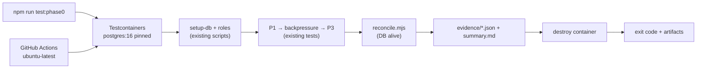

# OpenLevel Automated Testing Plan (prompt8 deliverable)

Planning only — no implementation in this document's pass. All repository
claims verified against the checkout 2026-11-14 (`master` @ `2634f8c`);
external claims cite inspected sources with access dates.

**Amendments (plan_prompt8, APPROVED WITH FIVE ADJUSTMENTS):** (1) single
lifecycle owner `test-env.ts`, no global-setup component; (2) exact
command contract plus vault known-failure baseline gate; (3) mandatory
Testcontainers networking verification on both platforms; (4) image pin
(digest + platform + SCRAM proof) required before acceptance; (5) explicit
full-suite-on-PR scope, branch-protection admin step, and measured timing
margins. Each amended section cites its adjustment number.

## 1. Current-state inspection and findings

**Repository (verified):** ESM package `openlevel@0.1.0`, engines
`node >= 22.0.0`, `@dbos-inc/dbos-sdk` pinned `5.5.0` exact. Scripts:
`typecheck` (`tsc -p tsconfig.json --noEmit`), `test` (`vitest run`),
plus `dev/build/migrate/seed/shoot`. No `lint` script, no `.github/`
directory (CI is greenfield), no `test:phase0` script.

**App suite (executed baseline, 2026-11-14):** typecheck clean (0 errors);
182 files / 1590 cases → 181 files, 1589 pass in 724s. Single failure is
pre-existing and deterministic: `server/lib/vault.test.ts` mixed-case
vs. all-caps secret-name bug. It stays separately classified; nothing in
this plan fixes, skips, or depends on it.

**Phase 0 suite (verified inventory):** 7 test files under `phase0/` —
`db-guard.test.ts` (24), `p1/outcome.test.ts` (2), `test-env.test.ts` (4),
`baseline-gate.test.ts` (4) = 34 unit cases green without a DB;
`p1/p1.test.ts` (9 DB tests), `p1/backpressure.test.ts` (1 DB test),
`p3/p3.test.ts` (11 DB tests) = 21 DB-backed cases, all BLOCKED awaiting
live PostgreSQL. Harness: `test-env.ts` (sole orchestrator), `db-guard.ts`
(target validation), `setup-db.ts` (sysdb + schemas + `phase0_rt`),
`preflight.ts`, `run-all.sh` (manual fallback), `check-suite.mjs` (JSON
verdicts), `reconcile.mjs`, `summary.mjs`, `baseline-gate.mjs`,
`vitest.phase0.config.ts` (`fileParallelism:false`), `phase0/tsconfig.json`.
Worker/entrypoint/boot scripts, crash runner, fake provider, CI workflows,
and evidence matrix all exist and typecheck clean.

**Key deltas from prior prose:** test counts above are file-verified, not
copied; the sandbox denies `bind`/raw-`connect`/`shmget` (re-probed), so
no database-backed proof can execute from the agent sandbox; the owner Mac
has no Docker, Postgres.app, or Homebrew (verified) — local container use
implies a Docker Desktop install.

## 2. Recommended architecture and rationale

**One harness, two provisioners, one entrypoint.** All tests keep calling
the existing guard/setup/worker/test code unchanged. Database provisioning
moves behind a single interface with two implementations:

- **Local (`npm run test:phase0`):** Testcontainers starts pinned
  `postgres:<major>` (see §4), waits for readiness, mints random
  credentials, hands the URL to the existing setup + suites, saves
  evidence, destroys the container. Requires Docker Desktop (new local
  prerequisite, costed honestly in §12).
- **CI (same command on `ubuntu-latest`):** identical Testcontainers path
  — GitHub-hosted runners ship Docker, so local and CI execute byte-for-
  byte the same provisioning code. No service-container YAML, no second
  implementation to drift.

Rationale: prompt8's core demand is one test implementation with
provisioning abstracted. Testcontainers-everywhere is the only option
that literally satisfies it; the sandbox constraint that motivated the
manual runbook does not apply to CI runners or the owner's Mac. The
manual runbook stays as the documented fallback diagnostic path.
Service containers are the recorded fallback if container-in-CI proves
flaky (see §3).

## 3. Testcontainers vs. service containers

| Criterion | A. Testcontainers (recommended) | B. GH service containers |
|---|---|---|
| Implementations | One: same code local + CI | Two paths unless local also uses containers |
| Control | Programmatic: per-run DBs, readiness probes, conditional retention | Declarative: one service, `pg_isready` gate |
| Local DX | One command after Docker install | Still needs manual local PG or second tool |
| CI fit | Native on ubuntu runners (Docker preinstalled) | Native, simplest YAML |
| Reproducibility | Pinned image digest in code; identical everywhere | Pinned image in YAML; local differs |
| Security | Random creds in-process; nothing committed | Random via job env; equivalent |
| Cost | Same runner minutes; ~10–30s container boot per run | Same minutes; faster boot (~5s) |
| New deps | `@testcontainers/postgresql` (+ transitive) | None |

Decision: **A**, because the failure mode being fixed is implementation
divergence between environments, and only A removes it. Revisit trigger:
measured CI flake rate from container startup exceeding 2% over 50 runs —
then adopt B for CI while keeping A locally, accepting the documented
divergence and a conformance check that both provision the same image.

## 4. Local developer workflow

Prerequisite: Docker Desktop installed and running (one-time owner action;
documented with version floor at implementation). Then:

```
npm run test:phase0
```

Single lifecycle owner (Adjustment 1): `phase0/test-env.ts` is the ONLY
orchestrator — it provisions the container, verifies it, runs setup,
supervises the DBOS worker through the existing runner, executes the
suites, reconciles, persists evidence, and tears down. There is no
vitest `globalSetup` component (its separate-scope `provide`/`inject`
handoff is a second lifecycle mechanism we refuse to carry); the
orchestrator passes plain environment variables to child processes.
Unit suites run first (fail fast, no container), then the container
lifecycle above. `PHASE0_KEEP_DB=1` retains the container on failure and
prints reconnect instructions (password shown once, never logged).
No Postgres.app, no manual roles, no DMG.

Command contract (Adjustment 2) — each test executes exactly once per
invocation, never twice:

| Command | Responsibility |
|---|---|
| `npm run test:phase0:unit` | Fast suites, no PostgreSQL/container |
| `npm run test:phase0:integration` | Container + P1/P3/backpressure + evidence |
| `npm run test:phase0` | Runs unit, then integration, exactly once each |

CI invokes either the combined command or the two component commands in
separate jobs — never combined-plus-components in one run.

## 5. Pull-request CI workflow

`.github/workflows/phase0.yml` on PR + push to `master`: checkout →
pinned Node 22 → `npm ci` → root typecheck → phase0 typecheck →
`npm run test:phase0` (unit, then integration per the §4 contract) →
upload sanitized artifacts always (`if: always()`). Single SIGKILL pass
(not ×20) and one full pass (no retained rerun).

Full-suite scope (Adjustment 5): the **full application suite runs on
every PR** in a parallel job — the 724s baseline is tolerable beside
integration time, and dropping the suite would trade away the only
regression net the app has. Speed comes from parallel jobs, not fewer
gates. The known `vault.test.ts` failure is handled by an explicit
baseline gate (Adjustment 2), never by exclusion: the job runs the whole
suite, tolerates exactly the one documented failure (file + test name
pinned in the workflow), displays it in the report, and fails on any
other failure or on the known failure disappearing (which means either a
fix landed — update the baseline — or the suite stopped running it).

Branch protection is a separate repository-administration action by the
owner (Adjustment 5 — creating workflow files does not configure it):
required checks = typecheck, unit, integration, full-suite-with-baseline.
Record the settings (required status checks, no bypass except admins)
in the implementation report; verify by opening a test PR before
declaring the gate live.

## 6. Extended reliability workflow

`.github/workflows/phase0-nightly.yml` on schedule + manual dispatch:
20× SIGKILL loop, retained-database rerun, race timing margins, full
reconciliation. Advisory (non-blocking) with failure notifications.
Same container image and harness; only the test selection and iteration
counts differ, driven by env (`PHASE0_SUITE=nightly`).

## 7. Deployment acceptance boundary

Unchanged from V2.1/P2: Fly Machine replacement, executor fencing, worker
heartbeat/drain, Neon direct-vs-pooled, and migrations prove ONLY on
staging Fly + Neon. No Testcontainers result is cited for deployment
semantics; no staging resource enters PR CI. A separate manual-dispatch
`staging-smoke.yml` (Fly + Neon branch) is backlog, not Phase 0.

## 8. Proposed package scripts and dependencies

Scripts (`package.json`, implementation phase): `test:phase0`
(orchestrator: unit then integration, each once), `test:phase0:unit`
(db-guard + outcome suites, no DB), `test:phase0:integration`
(container + P1/P3/backpressure + evidence),
`test:env:up|down` (diagnostic container control).
Dependencies: add `@testcontainers/postgresql` (exact pin at
implementation; record version + integrity like the SDK pin). No other
new runtime deps; `pg`, `vitest`, `tsx` already present. New files:
`phase0/test-env.ts` (sole lifecycle owner: provision, verify, setup,
worker supervision, execute, reconcile, persist, teardown),
`phase0/reconcile.mjs`, `phase0/summary.mjs`,
`.github/workflows/phase0.yml`, `.github/workflows/phase0-nightly.yml`.
Deliberately absent: any vitest global-setup component (Adjustment 1).

## 9. Proposed workflow files and permissions

- `.github/workflows/phase0.yml`: `contents: read`, no secrets, no
  environment protection (ephemeral DB only). Steps per §5; artifact
  upload `retention-days: 14`.
- `.github/workflows/phase0-nightly.yml`: same permissions; `schedule:
  cron` + `workflow_dispatch`; longer timeout (120 min); artifacts 30d.
- No `id-token: write`, no OIDC, no cloud credentials in either file.
  Staging workflow (future) gets its own restricted secrets — never shared.

## 10. Evidence and artifact lifecycle

Per run, all sanitized by the existing redaction (extended to any new
emitters): `results.json` (per-suite counts/timings/outcomes from the
JSON reporter), `summary.md` (one-page verdict + key counts, generated by
a small script from the JSON), `reconciliation.json` (provider journal vs.
ledger counts, from a new `phase0/reconcile.mjs` run pre-teardown),
`run.log` (redacted console), worker log (redacted). Capture order is
fixed: tests → reconcile (DB alive) → persist artifacts → destroy
container. Diagnostic mode (`PHASE0_KEEP_DB=1`) skips destruction and
prints the container id + redacted URL.

## 11. Security and automatic cleanup behavior

Preserved from the current package: disposable-target guard (unchanged
semantics, extended to container URLs: loopback-mapped ports only),
SCRAM (official image default for host auth; enforced explicitly, not
assumed), restricted runtime role (created by setup as today), bootstrap/
runtime separation, identity verification pre/post setup, redacted logs,
per-run identity (container label + `PHASE0_RUN_ID`), and cleanup that
stops/removes only resources tagged with the run label (verified by
listing before/after). Temporary credentials are generated inside the
provisioning process and never leave it except into the test process env.

Networking verification (Adjustment 3 — mandatory, not assumed): during
implementation, `test-env.ts` must log and the evidence must record, on
BOTH macOS Docker Desktop and Ubuntu GitHub runners: the container
runtime's reported host, the mapped port, the actual published interface
(from container inspection), and a successful guarded connect through the
existing `db-guard.ts` (which keeps enforcing loopback-only — the guard
is never weakened to accommodate Testcontainers). If either platform
publishes non-loopback, implementation stops and the finding is reported
instead of worked around.

## 12. Expected execution time and CI cost (estimates, not measurements)

Inputs (labeled): app suite 724s on Intel Mac (measured 2026-11-14);
P1/P3/backpressure unmeasured (BLOCKED) — bounded below by test design
(2–6s sleeps/timeouts per crash test, ~10s flood, worker cold start).
Linux 2-core $0.006/min; Free private allowance 2000 min/mo + 500MB
artifacts (secondary reports of official pricing, Oct–Nov 2026 — re-verify
at implementation; public repos free).

| Job | Est. wall time | Est. cost/run (past allowance) |
|---|---|---|
| PR: typecheck + unit | 2–4 min | $0.01–0.03 |
| PR: integration (P1/P3/BP + evidence) | 8–15 min | $0.05–0.09 |
| Nightly reliability (20× SIGKILL + reruns) | 25–45 min | $0.15–0.27 |

At 100 PR runs/month the integration job fits inside the Free allowance
(~1500 min worst case). Artifact volume per run is KB-scale JSON/Markdown
plus redacted logs — negligible against 500MB. First CI runs must replace
these estimates with measurements before any cost commitment.

Timing margins are measured, not estimated (Adjustment 5): the backpressure
elapsed bound, sampler overlap threshold, SIGKILL poll windows, and worker
readiness timeout each get an observed p50/p95 from the first three green
CI runs; any threshold with <2× margin is re-tuned or moved to nightly with
a note — never silently widened. The "under ~20 min" PR figure above is a
planning placeholder until those runs exist.

## 13. Migration steps from the current manual runbook

1. Land `test-env.ts` + scripts (no behavior change to
   tests; runbook still works — both paths coexist briefly). No global
   setup component (Adjustment 1).
2. Add `.github/workflows/phase0.yml` (non-required at first); confirm
   green on 3 consecutive runs including one forced-failure drill
   (redacted logs + correct non-zero exit verified).
3. Promote the three jobs to required branch protection; demote the
   manual runbook to "fallback diagnostic" in its header.
4. Add the nightly workflow; confirm the 20× loop + rerun reporting.
5. Retire manual-run evidence flow: matrix rows cite CI artifact URLs;
   keep `LOCAL_POSTGRES_RUNBOOK.md` for Docker-less debugging only.

## 14. Risks, assumptions, and acceptance criteria

- **Docker dependence (local):** owner Mac has no Docker (verified); local
  runs require a Docker Desktop install. Assumption: acceptable one-time
  cost; fallback is the manual runbook. If rejected, local defaults to
  CI-only iteration.
- **Timing-sensitive tests in CI:** backpressure elapsed bound, sampler
  overlap threshold, and SIGKILL poll windows were tuned mentally, not
  measured. First green CI runs must record margins; any threshold with
  <2× margin gets re-tuned or moved to nightly — never silently widened.
- **Image pin gate (Adjustment 4):** implementation is not accepted until
  it establishes the exact patch version, immutable multi-platform digest,
  selected platform + image ID, and explicit SCRAM configuration with the
  active rule verified — recorded in code and evidence, not just prose.
  Current official tags observed Nov 2026: `16.16`, `17.12` (recommend
  16-line for Neon-parity breadth; revisit if Neon target selects 17).
  Digest bumps thereafter follow a Dependabot/Renovate-style routine.
- **DBOS worker in CI:** worker lifecycle moves from `run-all.sh` into
  `test-env.ts` supervision (single owner, Adjustment 1); readiness
  detection stays log-based with a 60s timeout and a redacted dump on
  failure.
- **Coverage of the plan itself:** acceptance = §5 jobs green on 3 runs,
  artifacts complete per §10, matrix rows cite artifact URLs, and a
  forced-failure drill proves redaction + exit codes.



## 15. Ordered implementation backlog

| # | Item | Depends on | Definition of done |
|---|---|---|---|
| 1 | `phase0/test-env.ts`: full lifecycle (provision→verify→setup→supervise→execute→reconcile→persist→teardown) + `PHASE0_KEEP_DB` | — | Unit-tested URL/redaction logic; image pin + digest + platform recorded; networking verification logged per §11 |
| 2 | `test:phase0*` scripts per the §4 contract (no global setup) | 1 | `npm run test:phase0` runs full lifecycle locally with Docker; each suite executes exactly once |
| 3 | `reconcile.mjs` + `summary.md` generator | 1 | Golden-file test on fixture JSON; output matches §10 schema |
| 4 | `.github/workflows/phase0.yml` (non-required) incl. vault baseline gate | 2, 3 | 3 green runs; artifacts complete; forced-failure drill passes; baseline displays the known failure |
| 5 | Timing-margin review from first CI data | 4 | Each threshold shows ≥2× measured margin or moves to nightly with a note |
| 6 | Promote gates to required (owner admin action); demote runbook | 4, 5 | Branch protection set + verified by test PR; runbook header updated |
| 7 | `.github/workflows/phase0-nightly.yml` (20× + reruns) | 6 | Scheduled + manual runs green; failure notifications work |
| 8 | Staging-smoke design (Fly+Neon, manual dispatch) | 7 | Workflow drafted; secrets/approvals specified; NOT enabled |

Out of scope for this backlog: Fly/Neon provisioning, `vault.test.ts`
disposition, DBOS version bumps, and any application-code change.
